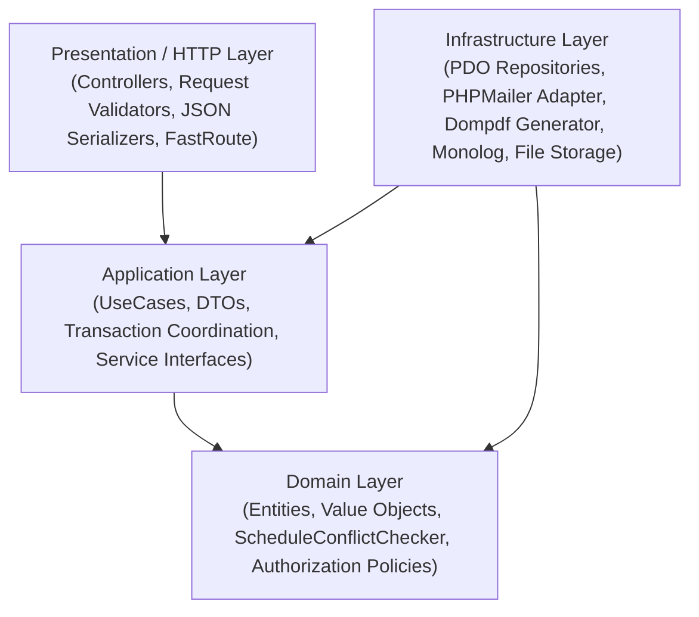

# Kampusly — Phase 2: System Architecture Specification

**Project:** Kampusly: A Web-Based Class Schedule Management and Notification System  
**Document:** `docs/architecture/system-architecture.md`  
**Version:** 1.0 • 28 October 2026  

---

## 1. Architectural Style: Modular Monolith with DDD Boundaries

Kampusly is architected as a **Modular Monolith** on the backend paired with a **Single-Page Application (SPA)** on the frontend:
- **Backend (`backend/`):** Native PHP 8.x with Composer PSR-4 autoloading (`Kampusly\` $\rightarrow$ `backend/src/`). No PHP backend framework (such as Laravel or Symfony) is used; routing, dependency wiring, controllers, application use cases, domain rules, and PDO repositories remain explicit and testable.
- **Frontend (`frontend/`):** Vue 3 + TypeScript + Vite SPA styled with Tailwind CSS + `shadcn-vue` primitives and `FullCalendar`, communicating exclusively with `/api/v1/*` over HTTP/HTTPS.
- **Database:** MySQL 8.4 accessed exclusively via PDO prepared statements and explicit database transactions.

---

## 2. Bounded Contexts and Layering Rules

### 2.1 Backend Bounded Contexts (`backend/src/`)

| Bounded Context | Core Responsibilities | Key Domain / Application Classes |
| :--- | :--- | :--- |
| **`Shared`** | Cross-cutting value objects, clock/timezone abstraction (`Asia/Manila` vs. UTC), pagination envelopes, base domain exceptions, request correlation IDs, and `AuditLogger` contract. | `ClockInterface`, `PaginatedResult`, `DomainException`, `ValidationException`, `AuditLoggerInterface` |
| **`IdentityAccess`** | User accounts, password hashing (`password_hash`/`password_verify`), session management, CSRF tokens, single-use hashed password reset tokens, and centralized authorization policies. | `User`, `Role`, `AuthenticateUserUseCase`, `RequestPasswordResetUseCase`, `ResetPasswordUseCase`, `AdminPolicy`, `InstructorPolicy`, `StudentPolicy` |
| **`Academic`** | Students, instructors, subjects, rooms, and sections reference data CRUD, uniqueness validation, and safe status deactivation. | `StudentProfile`, `InstructorProfile`, `Subject`, `Room`, `Section`, `CreateSubjectUseCase`, `AssignStudentSectionUseCase` |
| **`Scheduling`** | Master schedules, mathematical interval overlap rules (`ScheduleConflictChecker`), schedule publication, role-scoped schedule queries, and student schedule PDF export. | `Schedule`, `TimeSlot`, `ScheduleConflictChecker`, `CreateScheduleUseCase`, `UpdateScheduleUseCase`, `ExportStudentSchedulePdfUseCase` |
| **`Announcements`** | Subject/section announcements, publishing lifecycle (`draft`, `published`, `archived`, `withdrawn`), and private attachment validation/storage. | `Announcement`, `AnnouncementAttachment`, `AttachmentValidator`, `PublishAnnouncementUseCase` |
| **`ClassNotices`** | Instructor class-unavailability/change notices (`unavailable`, `cancelled`, `rescheduled`, `room_change`), hybrid approval workflow, and status transitions. | `ClassNotice`, `NoticeType`, `SubmitClassNoticeUseCase`, `ReviewClassNoticeUseCase`, `WithdrawClassNoticeUseCase` |
| **`Notifications`** | Recipient-specific in-app notifications, per-user `read_at` state, idempotent 30-minute class reminder generation (`deduplication_key`), and fault-isolated SMTP email dispatch. | `Notification`, `NotificationService`, `GenerateClassRemindersUseCase`, `MarkNotificationReadUseCase` |
| **`Bootstrap`** | Application factory, lightweight DI container (`Container.php`), route dispatcher, middleware pipeline, and global JSON `ErrorHandler.php`. | `ApplicationFactory`, `Container`, `ErrorHandler` |

### 2.2 Strict Four-Layer Dependency Rule



| Layer | Responsibility | Strictly Prohibited |
| :--- | :--- | :--- |
| **`Domain`** | Entities, value objects, invariants, `ScheduleConflictChecker`, and authorization policies. | `$_GET`/`$_POST`/`$_SESSION`, HTTP status codes, PDO/SQL queries, PHPMailer, Dompdf. |
| **`Application`** | Use-case orchestration (`execute()`), transaction boundaries, DTO mapping, calling domain services and repository/adapter interfaces. | Raw SQL strings, HTML/PDF templates, direct `header()`/`echo` output. |
| **`Infrastructure`** | Implementing repository interfaces with PDO prepared statements, PHPMailer SMTP transport, Dompdf rendering, filesystem storage, and Monolog. | Making business or authorization decisions that belong in `Domain` or `Application`. |
| **`Presentation\Http`** | Extracting HTTP input, running transport-shape validation, invoking one Application UseCase, and returning a status code + JSON/PDF response. | Multi-table business workflows, conflict math, or direct PDO queries. |

---

## 3. End-to-End Request Lifecycle

1. **Browser (Vue 3 SPA):** Sends an HTTP request (e.g., `POST /api/v1/schedules`) via `frontend/src/services/api/client.ts` with `credentials: 'include'` and the `X-CSRF-Token` header.
2. **Nginx Reverse Proxy (`infrastructure/nginx/`):** Serves static frontend assets directly and forwards `/api/*` requests via FastCGI (`php:9000`) to `backend/public/index.php` while blocking direct web access to internal directories.
3. **Front Controller & Bootstrap (`backend/public/index.php`):**
   - Loads environment configuration (`vlucas/phpdotenv` + `backend/config/*.php`), sets default timezone (`Asia/Manila`), assigns a unique `X-Request-Id`, and registers `ErrorHandler`.
4. **Middleware Pipeline:**
   - **Session Middleware:** Starts/resumes hardened PHP session (`HttpOnly`, `SameSite=Lax`, `Secure` in prod).
   - **CSRF Middleware:** Verifies `X-CSRF-Token` on `POST`/`PUT`/`PATCH`/`DELETE` requests.
   - **Rate-Limit Middleware:** Throttles `/auth/login` and `/auth/forgot-password`.
   - **Auth & Role Middleware:** Populates the current `AuthenticatedUser` context and verifies route role requirements (`401` / `403`).
5. **Router & Controller (`backend/routes/api.php`):** Dispatches via `FastRoute` to the target controller action, which validates request payload fields (`422` on failure) and constructs a typed Request DTO.
6. **Application Use Case & Transaction Boundary:**
   - Opens a PDO transaction (`$db->beginTransaction()`) for write operations.
   - Executes domain policies (`InstructorPolicy`, `StudentPolicy`, `AdminPolicy`) and domain services (`ScheduleConflictChecker`).
   - Persists state via PDO repositories, writes `audit_logs` and `notifications`, and commits (`$db->commit()`).
7. **Post-Commit Infrastructure Side Effects:**
   - If optional SMTP email delivery is enabled, dispatches via `SmtpMailer` and records delivery status in `notification_deliveries` so SMTP latency or failure never rolls back the committed database state.
8. **HTTP Response:** Returns a standardized JSON envelope (`200`/`201`/`204` or `ErrorEnvelope`) with security headers.

---

## 4. Security, Accessibility, and Performance Design Controls (Task 11)

| Area | Design Control | Phase Implemented & Verified |
| :--- | :--- | :--- |
| **Authentication & Sessions** | `password_hash()`/`password_verify()`, `session_regenerate_id(true)` on login/privilege change, `HttpOnly` + `SameSite=Lax` + `Secure` cookies, session invalidation on logout and password reset. | Phase 3 (Backend `IdentityAccess` + Integration Tests) |
| **CSRF Defense** | Synchronizer token stored in `$_SESSION['csrf_token']`, exposed via `/auth/login` and `/auth/me`, sent in `X-CSRF-Token` header on all state-changing requests. | Phase 3 (HTTP Middleware + Feature Tests) |
| **XSS & Output Encoding** | Vue 3 automatic template escaping; JSON `Content-Type: application/json; charset=utf-8` responses; `X-Content-Type-Options: nosniff` and CSP headers in `security-headers.conf`; HTML escaping in Dompdf templates. | Phase 1–3 (Nginx + Frontend + PDF Templates) |
| **SQL Injection Prevention** | 100% PDO prepared statements (`ATTR_EMULATE_PREPARES => false`); strict allow-list map for sort/filter column names. | Phase 3 (PDO Repositories + PHPStan) |
| **RBAC & Ownership** | Centralized `AdminPolicy`, `InstructorPolicy` (verifies `schedules.instructor_id`), and `StudentPolicy` (derives `section_id`/`user_id` from session). | Phase 3–6 (Domain Policies + Authorization Test Suite) |
| **Safe Uploads** | `finfo_file()` MIME check + extension allow-list (`.pdf`, `.png`, `.jpg`, `.jpeg`) + $\le 5\text{ MB}$ limit + UUID storage key in `backend/storage/uploads/` outside `backend/public/`. | Phase 6 (Announcements Module + Upload Security Tests) |
| **Rate Limiting** | Sliding-window counter per IP + email hash on `/auth/login` and `/auth/forgot-password` returning `429 Too Many Requests`. | Phase 3 (Auth Middleware + Feature Tests) |
| **Accessible Contrast & Keyboard UX** | WCAG AA contrast tokens (`tokens.css`), visible `:focus-visible` rings, semantic landmarks, `Escape` dismissal on menus/modals, non-color status badges, `@media (prefers-reduced-motion: reduce)`. | Phase 1–8 (Frontend Components + Vitest / A11y Checks) |
| **Database Indexing & Query Efficiency** | Composite indexes on `schedules` conflict columns, `notifications (user_id, read_at, created_at)`, and server-side pagination (`per_page <= 100`). | Phase 3–5 (Migrations + Query Plan Review) |

---

## 5. Aligned Repository Directory Structure

```text
kampusly/
├── frontend/
│   ├── public/
│   │   ├── favicon.svg
│   │   └── images/
│   ├── src/
│   │   ├── app/
│   │   │   ├── App.vue
│   │   │   ├── main.ts
│   │   │   ├── router/
│   │   │   │   ├── index.ts
│   │   │   │   └── guards.ts
│   │   │   └── layouts/
│   │   │       ├── AuthLayout.vue
│   │   │       ├── StudentLayout.vue
│   │   │       ├── InstructorLayout.vue
│   │   │       └── AdminLayout.vue
│   │   ├── assets/styles/
│   │   │   ├── main.css
│   │   │   └── tokens.css
│   │   ├── components/
│   │   │   ├── ui/               # shadcn-vue shared primitives
│   │   │   ├── common/           # AppIcon, BaseButton, KampuslyLogo, ThemeToggle
│   │   │   ├── forms/
│   │   │   ├── data-display/
│   │   │   └── feedback/
│   │   ├── composables/          # useTheme, useScrollSpy, useAuth
│   │   ├── features/
│   │   │   ├── landing/
│   │   │   ├── auth/
│   │   │   ├── student/
│   │   │   ├── instructor/
│   │   │   ├── admin/
│   │   │   ├── academic/         # students, instructors, subjects, rooms, sections
│   │   │   ├── schedules/        # pages, components, calendar, tests
│   │   │   ├── announcements/
│   │   │   ├── class-notices/
│   │   │   └── notifications/
│   │   ├── services/api/         # client.ts, errors.ts, endpoints.ts
│   │   ├── types/
│   │   └── utils/
│   ├── index.html
│   ├── package.json
│   ├── tailwind.config.ts
│   └── vite.config.ts
├── backend/
│   ├── public/
│   │   └── index.php             # Single HTTP entry point
│   ├── routes/
│   │   ├── api.php               # /api/v1 route declarations
│   │   └── health.php
│   ├── src/
│   │   ├── Bootstrap/            # ApplicationFactory.php, Container.php, ErrorHandler.php
│   │   ├── Shared/               # Domain, Application, Infrastructure
│   │   ├── IdentityAccess/       # Domain, Application, Infrastructure, Presentation/Http
│   │   ├── Academic/             # Domain, Application, Infrastructure, Presentation/Http
│   │   ├── Scheduling/           # Domain, Application, Infrastructure, Presentation/Http
│   │   ├── Announcements/        # Domain, Application, Infrastructure, Presentation/Http
│   │   ├── ClassNotices/         # Domain, Application, Infrastructure, Presentation/Http
│   │   └── Notifications/        # Domain, Application, Infrastructure, Presentation/Http
│   ├── config/                   # app.php, database.php, mail.php, security.php, logging.php
│   ├── database/
│   │   ├── migrations/
│   │   └── seeders/
│   ├── resources/
│   │   ├── email/password-reset/
│   │   └── pdf/schedule/
│   ├── storage/                  # logs/, cache/, tmp/, uploads/ (outside public/)
│   ├── bin/                      # migrate.php, seed.php, generate-reminders.php, health-check.php
│   ├── tests/                    # Unit/, Integration/, Feature/, Support/
│   ├── composer.json
│   ├── phpunit.xml
│   ├── phpstan.neon
│   └── phpcs.xml
├── infrastructure/               # docker/, nginx/, prometheus/, grafana/, scripts/
├── docs/                         # requirements/, phase-2/, architecture/, api/, database/, runbooks/
├── .github/workflows/
├── .env.example
└── docker-compose.yml
```

