# Kampusly — Phase 2: Database Design and ER Specification

**Project:** Kampusly: A Web-Based Class Schedule Management and Notification System  
**Document:** `docs/database/database-design.md`  
**Database Engine:** MySQL 8.4 (`InnoDB`, `utf8mb4`, `utf8mb4_unicode_ci`)  
**Version:** 1.0 • 28 October 2026  

---

## 1. Conceptual vs. Physical Database Design

### 1.1 Conceptual Domain Model
At the conceptual domain level (matching Diagram 4 and Diagram 6 of the system blueprint), Kampusly models **10 core domain entities**:
- **Identity & Actors:** `User`, `Student`, `Instructor`
- **Academic Reference Data:** `Section`, `Subject`, `Room`
- **Core Scheduling & Communication:** `Schedule`, `Announcement`, `ClassNotice`, `Notification`

### 1.2 Physical Schema Extensions (Justified by Approved Phase 1 Requirements)
To satisfy the approved security, reliability, and attachment requirements (`FR-AUTH-05`–`06`, `FR-ANN-03`, `FR-NOTIF-06`, `FR-ADM-02`, `NFR-SEC-02`, `NFR-SEC-07`), the physical MySQL 8.4 schema adds **4 focused supporting tables** (for a total of **14 tables**):
1. **`password_reset_tokens`:** Stores single-use SHA-256 token hashes (`token_hash`), expiration (`expires_at`), and consumption (`used_at`) timestamps (`FR-AUTH-05`, `FR-AUTH-06`).
2. **`announcement_attachments`:** Stores metadata and private storage keys (`storage_key`) for files attached to announcements outside the public web root (`FR-ANN-03`, `NFR-SEC-07`).
3. **`audit_logs`:** Records security-sensitive and administrative mutations (`actor_user_id`, `action`, `entity_type`, `entity_id`, `metadata_json`, `request_id`) (`FR-ADM-02`).
4. **`notification_deliveries`:** Tracks external channel delivery state (`email` via PHPMailer/SMTP, `attempt_count`, `status`, `last_error`) independently of the in-app `notifications` record (`FR-NOTIF-06`, `NFR-REL-03`).

> **Harmonization Note (`DEC-06`):** The physical schema reconciles all field names between Diagram 6 (ERD) and System Development Plan Section 10 (e.g., `users.full_name` alongside `first_name`/`last_name` on profiles; `announcements` supporting `author_user_id`, `instructor_id`, `subject_id`, `section_id`, and `message`).

---

## 2. Entity-Relationship Diagram (Mermaid `erDiagram`)

```mermaid
erDiagram
    USERS ||--o| STUDENTS : "has profile (0..1)"
    USERS ||--o| INSTRUCTORS : "has profile (0..1)"
    USERS ||--o{ NOTIFICATIONS : "receives (0..*)"
    USERS ||--o{ ANNOUNCEMENTS : "authors (0..*)"
    USERS ||--o{ PASSWORD_RESET_TOKENS : "requests (0..*)"
    USERS ||--o{ AUDIT_LOGS : "performs (0..*)"

    SECTIONS ||--o{ STUDENTS : "contains (0..*)"
    SECTIONS ||--o{ SCHEDULES : "assigned (0..*)"
    SECTIONS ||--o{ ANNOUNCEMENTS : "targeted to (0..*)"

    INSTRUCTORS ||--o{ SCHEDULES : "teaches (0..*)"
    INSTRUCTORS ||--o{ ANNOUNCEMENTS : "publishes (0..*)"
    INSTRUCTORS ||--o{ CLASS_NOTICES : "submits (0..*)"

    SUBJECTS ||--o{ SCHEDULES : "scheduled as (0..*)"
    SUBJECTS ||--o{ ANNOUNCEMENTS : "concerns (0..*)"

    ROOMS ||--o{ SCHEDULES : "hosts (0..*)"
    ROOMS ||--o{ CLASS_NOTICES : "new room for (0..*)"

    SCHEDULES ||--o{ CLASS_NOTICES : "relates to (0..*)"
    ANNOUNCEMENTS ||--o{ ANNOUNCEMENT_ATTACHMENTS : "has (0..*)"
    NOTIFICATIONS ||--o{ NOTIFICATION_DELIVERIES : "delivered via (0..*)"

    USERS {
        bigint_unsigned id PK
        varchar_150 full_name
        varchar_191 email UK
        varchar_255 password_hash
        enum role "admin, instructor, student"
        enum status "active, inactive"
        datetime email_verified_at
        datetime last_login_at
        datetime created_at
        datetime updated_at
    }

    SECTIONS {
        bigint_unsigned id PK
        varchar_80 section_name
        varchar_120 program
        tinyint_unsigned year_level
        varchar_20 school_year
        enum semester "1st, 2nd, Summer"
        enum status "active, inactive"
        datetime created_at
        datetime updated_at
    }

    STUDENTS {
        bigint_unsigned id PK
        bigint_unsigned user_id FK, UK
        bigint_unsigned section_id FK
        varchar_50 student_number UK
        varchar_80 first_name
        varchar_80 last_name
        varchar_120 program
        datetime created_at
        datetime updated_at
    }

    INSTRUCTORS {
        bigint_unsigned id PK
        bigint_unsigned user_id FK, UK
        varchar_50 employee_number UK
        varchar_80 first_name
        varchar_80 last_name
        varchar_120 department
        datetime created_at
        datetime updated_at
    }

    SUBJECTS {
        bigint_unsigned id PK
        varchar_40 subject_code UK
        varchar_150 subject_name
        text description
        tinyint_unsigned units
        enum status "active, inactive"
        datetime created_at
        datetime updated_at
    }

    ROOMS {
        bigint_unsigned id PK
        varchar_40 room_code UK
        varchar_100 room_name UK
        varchar_100 building
        smallint_unsigned capacity
        enum status "active, inactive"
        datetime created_at
        datetime updated_at
    }

    SCHEDULES {
        bigint_unsigned id PK
        bigint_unsigned subject_id FK
        bigint_unsigned instructor_id FK
        bigint_unsigned room_id FK
        bigint_unsigned section_id FK
        varchar_20 school_year
        enum semester "1st, 2nd, Summer"
        enum day_of_week "Monday..Saturday"
        time start_time
        time end_time
        enum status "draft, published, cancelled"
        datetime created_at
        datetime updated_at
    }

    ANNOUNCEMENTS {
        bigint_unsigned id PK
        bigint_unsigned author_user_id FK
        bigint_unsigned instructor_id FK
        bigint_unsigned subject_id FK
        bigint_unsigned section_id FK
        varchar_150 title
        text message
        enum status "draft, published, archived, withdrawn"
        datetime published_at
        datetime created_at
        datetime updated_at
    }

    ANNOUNCEMENT_ATTACHMENTS {
        bigint_unsigned id PK
        bigint_unsigned announcement_id FK
        varchar_255 storage_key UK
        varchar_255 original_name
        varchar_100 mime_type
        int_unsigned size_bytes
        datetime created_at
    }

    CLASS_NOTICES {
        bigint_unsigned id PK
        bigint_unsigned schedule_id FK
        bigint_unsigned instructor_id FK
        enum notice_type "unavailable, cancelled, rescheduled, room_change"
        date affected_date
        varchar_150 title
        text message
        bigint_unsigned new_room_id FK
        date new_date
        time new_start_time
        time new_end_time
        enum status "pending_approval, published, rejected, withdrawn"
        bigint_unsigned reviewed_by_user_id FK
        text rejection_reason
        datetime reviewed_at
        datetime created_at
        datetime updated_at
    }

    NOTIFICATIONS {
        bigint_unsigned id PK
        bigint_unsigned user_id FK
        varchar_150 title
        text message
        enum type "class_reminder, announcement, class_notice, schedule_update"
        varchar_50 reference_type
        bigint_unsigned reference_id
        varchar_191 deduplication_key UK
        datetime read_at
        datetime created_at
    }

    NOTIFICATION_DELIVERIES {
        bigint_unsigned id PK
        bigint_unsigned notification_id FK
        enum channel "email"
        enum status "pending, sent, failed"
        tinyint_unsigned attempt_count
        text last_error
        datetime delivered_at
        datetime created_at
        datetime updated_at
    }

    PASSWORD_RESET_TOKENS {
        bigint_unsigned id PK
        bigint_unsigned user_id FK
        char_64 token_hash UK
        datetime expires_at
        datetime used_at
        datetime created_at
    }

    AUDIT_LOGS {
        bigint_unsigned id PK
        bigint_unsigned actor_user_id FK
        varchar_80 action
        varchar_60 entity_type
        bigint_unsigned entity_id
        json metadata_json
        varchar_64 request_id
        datetime created_at
    }
```

---

## 3. Physical Table Specifications (Data Dictionary)

### 3.1 `users`
Stores authentication credentials, system role, and account status for all users.

| Column | Type | Null | Default | Constraints & Notes |
| :--- | :--- | :---: | :--- | :--- |
| `id` | `BIGINT UNSIGNED` | `NO` | `AUTO_INCREMENT` | `PRIMARY KEY` |
| `full_name` | `VARCHAR(150)` | `NO` | — | Display name (synced with profile `first_name` + `last_name` where applicable) |
| `email` | `VARCHAR(191)` | `NO` | — | `UNIQUE KEY uk_users_email` (stored lowercase) |
| `password_hash` | `VARCHAR(255)` | `NO` | — | Bcrypt / Argon2id hash from `password_hash()` |
| `role` | `ENUM('admin','instructor','student')` | `NO` | — | `INDEX idx_users_role_status (role, status)` |
| `status` | `ENUM('active','inactive')` | `NO` | `'active'` | Inactive users cannot authenticate or hold active sessions |
| `email_verified_at` | `DATETIME` | `YES` | `NULL` | Optional email verification timestamp |
| `last_login_at` | `DATETIME` | `YES` | `NULL` | Updated on successful sign-in |
| `created_at` | `DATETIME` | `NO` | `CURRENT_TIMESTAMP` | UTC timestamp |
| `updated_at` | `DATETIME` | `NO` | `CURRENT_TIMESTAMP ON UPDATE CURRENT_TIMESTAMP` | UTC timestamp |

---

### 3.2 `sections`
Represents academic class groups/cohorts (e.g., `BSCS 2A`).

| Column | Type | Null | Default | Constraints & Notes |
| :--- | :--- | :---: | :--- | :--- |
| `id` | `BIGINT UNSIGNED` | `NO` | `AUTO_INCREMENT` | `PRIMARY KEY` |
| `section_name` | `VARCHAR(80)` | `NO` | — | e.g., `'BSCS 2A'` |
| `program` | `VARCHAR(120)` | `NO` | — | e.g., `'BS Computer Science'` |
| `year_level` | `TINYINT UNSIGNED` | `NO` | — | `1` to `6` |
| `school_year` | `VARCHAR(20)` | `NO` | — | e.g., `'2026-2027'` (maps to ERD `academic_year`) |
| `semester` | `ENUM('1st','2nd','Summer')` | `NO` | `'1st'` | `UNIQUE KEY uk_sections_term_name (school_year, semester, section_name)` |
| `status` | `ENUM('active','inactive')` | `NO` | `'active'` | `INDEX idx_sections_status (status)` |
| `created_at` | `DATETIME` | `NO` | `CURRENT_TIMESTAMP` | — |
| `updated_at` | `DATETIME` | `NO` | `CURRENT_TIMESTAMP ON UPDATE CURRENT_TIMESTAMP` | — |

---

### 3.3 `students`
Role-specific profile for users with `role = 'student'`.

| Column | Type | Null | Default | Constraints & Notes |
| :--- | :--- | :---: | :--- | :--- |
| `id` | `BIGINT UNSIGNED` | `NO` | `AUTO_INCREMENT` | `PRIMARY KEY` |
| `user_id` | `BIGINT UNSIGNED` | `NO` | — | `UNIQUE KEY uk_students_user_id`, `FK -> users(id) ON DELETE RESTRICT` |
| `section_id` | `BIGINT UNSIGNED` | `NO` | — | `FK -> sections(id) ON DELETE RESTRICT`, `INDEX idx_students_section_id (section_id)` |
| `student_number` | `VARCHAR(50)` | `NO` | — | `UNIQUE KEY uk_students_student_number` (e.g., `'2024-00142'`) |
| `first_name` | `VARCHAR(80)` | `NO` | — | — |
| `last_name` | `VARCHAR(80)` | `NO` | — | `INDEX idx_students_name (last_name, first_name)` |
| `program` | `VARCHAR(120)` | `NO` | — | e.g., `'BS Computer Science'` |
| `created_at` | `DATETIME` | `NO` | `CURRENT_TIMESTAMP` | — |
| `updated_at` | `DATETIME` | `NO` | `CURRENT_TIMESTAMP ON UPDATE CURRENT_TIMESTAMP` | — |

---

### 3.4 `instructors`
Role-specific profile for users with `role = 'instructor'`.

| Column | Type | Null | Default | Constraints & Notes |
| :--- | :--- | :---: | :--- | :--- |
| `id` | `BIGINT UNSIGNED` | `NO` | `AUTO_INCREMENT` | `PRIMARY KEY` |
| `user_id` | `BIGINT UNSIGNED` | `NO` | — | `UNIQUE KEY uk_instructors_user_id`, `FK -> users(id) ON DELETE RESTRICT` |
| `employee_number` | `VARCHAR(50)` | `NO` | — | `UNIQUE KEY uk_instructors_employee_number` (e.g., `'EMP-1024'`) |
| `first_name` | `VARCHAR(80)` | `NO` | — | — |
| `last_name` | `VARCHAR(80)` | `NO` | — | `INDEX idx_instructors_name (last_name, first_name)` |
| `department` | `VARCHAR(120)` | `NO` | — | e.g., `'Department of Computer Studies'` |
| `created_at` | `DATETIME` | `NO` | `CURRENT_TIMESTAMP` | — |
| `updated_at` | `DATETIME` | `NO` | `CURRENT_TIMESTAMP ON UPDATE CURRENT_TIMESTAMP` | — |

---

### 3.5 `subjects`
Academic courses/subjects offered by the institution.

| Column | Type | Null | Default | Constraints & Notes |
| :--- | :--- | :---: | :--- | :--- |
| `id` | `BIGINT UNSIGNED` | `NO` | `AUTO_INCREMENT` | `PRIMARY KEY` |
| `subject_code` | `VARCHAR(40)` | `NO` | — | `UNIQUE KEY uk_subjects_subject_code` (e.g., `'CS 201'`) |
| `subject_name` | `VARCHAR(150)` | `NO` | — | e.g., `'Data Structures and Algorithms'` |
| `description` | `TEXT` | `YES` | `NULL` | Optional syllabus/course summary |
| `units` | `TINYINT UNSIGNED` | `NO` | `3` | Credit units ($> 0$) |
| `status` | `ENUM('active','inactive')` | `NO` | `'active'` | `INDEX idx_subjects_status (status)` |
| `created_at` | `DATETIME` | `NO` | `CURRENT_TIMESTAMP` | — |
| `updated_at` | `DATETIME` | `NO` | `CURRENT_TIMESTAMP ON UPDATE CURRENT_TIMESTAMP` | — |

---

### 3.6 `rooms`
Physical or virtual classrooms where scheduled sessions take place.

| Column | Type | Null | Default | Constraints & Notes |
| :--- | :--- | :---: | :--- | :--- |
| `id` | `BIGINT UNSIGNED` | `NO` | `AUTO_INCREMENT` | `PRIMARY KEY` |
| `room_code` | `VARCHAR(40)` | `NO` | — | `UNIQUE KEY uk_rooms_room_code` (e.g., `'RM-304'`) |
| `room_name` | `VARCHAR(100)` | `NO` | — | `UNIQUE KEY uk_rooms_room_name` (e.g., `'Room 304'`) |
| `building` | `VARCHAR(100)` | `NO` | — | e.g., `'Main Academic Building'` |
| `capacity` | `SMALLINT UNSIGNED` | `NO` | `40` | Seating capacity ($> 0$) |
| `status` | `ENUM('active','inactive')` | `NO` | `'active'` | `INDEX idx_rooms_status (status)` |
| `created_at` | `DATETIME` | `NO` | `CURRENT_TIMESTAMP` | — |
| `updated_at` | `DATETIME` | `NO` | `CURRENT_TIMESTAMP ON UPDATE CURRENT_TIMESTAMP` | — |

---

### 3.7 `schedules`
Recurring weekly class meetings for a given academic term (`school_year` + `semester`). If a subject meets on multiple days (e.g., Monday and Wednesday), each meeting day is stored as its own normalized row in `schedules`.

| Column | Type | Null | Default | Constraints & Notes |
| :--- | :--- | :---: | :--- | :--- |
| `id` | `BIGINT UNSIGNED` | `NO` | `AUTO_INCREMENT` | `PRIMARY KEY` |
| `subject_id` | `BIGINT UNSIGNED` | `NO` | — | `FK -> subjects(id) ON DELETE RESTRICT` |
| `instructor_id` | `BIGINT UNSIGNED` | `NO` | — | `FK -> instructors(id) ON DELETE RESTRICT` |
| `room_id` | `BIGINT UNSIGNED` | `NO` | — | `FK -> rooms(id) ON DELETE RESTRICT` |
| `section_id` | `BIGINT UNSIGNED` | `NO` | — | `FK -> sections(id) ON DELETE RESTRICT` |
| `school_year` | `VARCHAR(20)` | `NO` | — | e.g., `'2026-2027'` |
| `semester` | `ENUM('1st','2nd','Summer')` | `NO` | `'1st'` | — |
| `day_of_week` | `ENUM('Monday','Tuesday','Wednesday','Thursday','Friday','Saturday')` | `NO` | — | Recurring weekly day |
| `start_time` | `TIME` | `NO` | — | Campus local time (`Asia/Manila`), e.g., `'08:00:00'` |
| `end_time` | `TIME` | `NO` | — | Campus local time (`Asia/Manila`); `CHECK (start_time < end_time)` |
| `status` | `ENUM('draft','published','cancelled')` | `NO` | `'draft'` | `'cancelled'` excluded from overlap blocking |
| `created_at` | `DATETIME` | `NO` | `CURRENT_TIMESTAMP` | — |
| `updated_at` | `DATETIME` | `NO` | `CURRENT_TIMESTAMP ON UPDATE CURRENT_TIMESTAMP` | — |

**Composite Indexes on `schedules`:**
- `idx_schedules_room_conflict (school_year, semester, day_of_week, room_id, status, start_time, end_time)`
- `idx_schedules_instructor_conflict (school_year, semester, day_of_week, instructor_id, status, start_time, end_time)`
- `idx_schedules_section_conflict (school_year, semester, day_of_week, section_id, status, start_time, end_time)`
- `idx_schedules_reminder_window (status, day_of_week, start_time)`

---

### 3.8 `announcements` & `announcement_attachments`
Subject/section announcements authored by an assigned Instructor or an Administrator.

**Table: `announcements`**

| Column | Type | Null | Default | Constraints & Notes |
| :--- | :--- | :---: | :--- | :--- |
| `id` | `BIGINT UNSIGNED` | `NO` | `AUTO_INCREMENT` | `PRIMARY KEY` |
| `author_user_id` | `BIGINT UNSIGNED` | `NO` | — | `FK -> users(id) ON DELETE RESTRICT` |
| `instructor_id` | `BIGINT UNSIGNED` | `YES` | `NULL` | `FK -> instructors(id) ON DELETE SET NULL` (populated when authored by instructor) |
| `subject_id` | `BIGINT UNSIGNED` | `NO` | — | `FK -> subjects(id) ON DELETE RESTRICT` |
| `section_id` | `BIGINT UNSIGNED` | `YES` | `NULL` | `FK -> sections(id) ON DELETE RESTRICT` (`NULL` = all sections assigned to `subject_id` for that author) |
| `title` | `VARCHAR(150)` | `NO` | — | — |
| `message` | `TEXT` | `NO` | — | Maps to ERD `content` |
| `status` | `ENUM('draft','published','archived','withdrawn')` | `NO` | `'draft'` | `INDEX idx_announcements_feed (subject_id, status, published_at DESC)` |
| `published_at` | `DATETIME` | `YES` | `NULL` | Set when transitioning to `'published'` |
| `created_at` | `DATETIME` | `NO` | `CURRENT_TIMESTAMP` | — |
| `updated_at` | `DATETIME` | `NO` | `CURRENT_TIMESTAMP ON UPDATE CURRENT_TIMESTAMP` | — |

**Table: `announcement_attachments`**

| Column | Type | Null | Default | Constraints & Notes |
| :--- | :--- | :---: | :--- | :--- |
| `id` | `BIGINT UNSIGNED` | `NO` | `AUTO_INCREMENT` | `PRIMARY KEY` |
| `announcement_id` | `BIGINT UNSIGNED` | `NO` | — | `FK -> announcements(id) ON DELETE CASCADE` |
| `storage_key` | `VARCHAR(255)` | `NO` | — | `UNIQUE KEY uk_attachments_storage_key` (path inside `backend/storage/uploads/`) |
| `original_name` | `VARCHAR(255)` | `NO` | — | Sanitized display filename |
| `mime_type` | `VARCHAR(100)` | `NO` | — | Allow-listed (`application/pdf`, `image/png`, `image/jpeg`) |
| `size_bytes` | `INT UNSIGNED` | `NO` | — | $\le 5,242,880$ bytes (`5 MB`) |
| `created_at` | `DATETIME` | `NO` | `CURRENT_TIMESTAMP` | — |

---

### 3.9 `class_notices`
Date-specific occurrence notices (`unavailable`, `cancelled`, `rescheduled`, `room_change`) tied to a `schedule_id`.

| Column | Type | Null | Default | Constraints & Notes |
| :--- | :--- | :---: | :--- | :--- |
| `id` | `BIGINT UNSIGNED` | `NO` | `AUTO_INCREMENT` | `PRIMARY KEY` |
| `schedule_id` | `BIGINT UNSIGNED` | `NO` | — | `FK -> schedules(id) ON DELETE RESTRICT` |
| `instructor_id` | `BIGINT UNSIGNED` | `NO` | — | `FK -> instructors(id) ON DELETE RESTRICT` |
| `notice_type` | `ENUM('unavailable','cancelled','rescheduled','room_change')` | `NO` | — | — |
| `affected_date` | `DATE` | `NO` | — | Specific occurrence date (`INDEX idx_notices_schedule_date (schedule_id, affected_date, status)`) |
| `title` | `VARCHAR(150)` | `NO` | — | Generated or user-entered summary |
| `message` | `TEXT` | `NO` | — | Explanation for students/admins |
| `new_room_id` | `BIGINT UNSIGNED` | `YES` | `NULL` | `FK -> rooms(id) ON DELETE SET NULL` (when `notice_type = 'room_change'`) |
| `new_date` | `DATE` | `YES` | `NULL` | Proposed makeup/rescheduled date (when `notice_type = 'rescheduled'`) |
| `new_start_time` | `TIME` | `YES` | `NULL` | Proposed start time |
| `new_end_time` | `TIME` | `YES` | `NULL` | Proposed end time |
| `status` | `ENUM('pending_approval','published','rejected','withdrawn')` | `NO` | `'published'` | `'pending_approval'` for `room_change`/`rescheduled` |
| `reviewed_by_user_id` | `BIGINT UNSIGNED` | `YES` | `NULL` | `FK -> users(id) ON DELETE SET NULL` |
| `rejection_reason` | `TEXT` | `YES` | `NULL` | Required when `status = 'rejected'` |
| `reviewed_at` | `DATETIME` | `YES` | `NULL` | — |
| `created_at` | `DATETIME` | `NO` | `CURRENT_TIMESTAMP` | — |
| `updated_at` | `DATETIME` | `NO` | `CURRENT_TIMESTAMP ON UPDATE CURRENT_TIMESTAMP` | — |

---

### 3.10 `notifications` & `notification_deliveries`
Recipient-owned in-app notifications and optional external email delivery tracking.

**Table: `notifications`**

| Column | Type | Null | Default | Constraints & Notes |
| :--- | :--- | :---: | :--- | :--- |
| `id` | `BIGINT UNSIGNED` | `NO` | `AUTO_INCREMENT` | `PRIMARY KEY` |
| `user_id` | `BIGINT UNSIGNED` | `NO` | — | `FK -> users(id) ON DELETE CASCADE`, `INDEX idx_notifications_user_unread (user_id, read_at, created_at DESC)` |
| `title` | `VARCHAR(150)` | `NO` | — | — |
| `message` | `TEXT` | `NO` | — | — |
| `type` | `ENUM('class_reminder','announcement','class_notice','schedule_update')` | `NO` | — | — |
| `reference_type` | `VARCHAR(50)` | `YES` | `NULL` | `'schedule'`, `'announcement'`, `'class_notice'` |
| `reference_id` | `BIGINT UNSIGNED` | `YES` | `NULL` | ID of the referenced record |
| `deduplication_key` | `VARCHAR(191)` | `YES` | `NULL` | `UNIQUE KEY uk_notifications_dedup_key` (e.g., `'reminder:102:2026-11-02:45'`) |
| `read_at` | `DATETIME` | `YES` | `NULL` | `NULL` = unread; timestamp = read |
| `created_at` | `DATETIME` | `NO` | `CURRENT_TIMESTAMP` | — |

**Table: `notification_deliveries`**

| Column | Type | Null | Default | Constraints & Notes |
| :--- | :--- | :---: | :--- | :--- |
| `id` | `BIGINT UNSIGNED` | `NO` | `AUTO_INCREMENT` | `PRIMARY KEY` |
| `notification_id` | `BIGINT UNSIGNED` | `NO` | — | `FK -> notifications(id) ON DELETE CASCADE` |
| `channel` | `ENUM('email')` | `NO` | `'email'` | `UNIQUE KEY uk_delivery_notif_channel (notification_id, channel)` |
| `status` | `ENUM('pending','sent','failed')` | `NO` | `'pending'` | — |
| `attempt_count` | `TINYINT UNSIGNED` | `NO` | `0` | — |
| `last_error` | `TEXT` | `YES` | `NULL` | Redacted SMTP error summary |
| `delivered_at` | `DATETIME` | `YES` | `NULL` | — |
| `created_at` | `DATETIME` | `NO` | `CURRENT_TIMESTAMP` | — |
| `updated_at` | `DATETIME` | `NO` | `CURRENT_TIMESTAMP ON UPDATE CURRENT_TIMESTAMP` | — |

---

### 3.11 `password_reset_tokens` & `audit_logs`

**Table: `password_reset_tokens`**

| Column | Type | Null | Default | Constraints & Notes |
| :--- | :--- | :---: | :--- | :--- |
| `id` | `BIGINT UNSIGNED` | `NO` | `AUTO_INCREMENT` | `PRIMARY KEY` |
| `user_id` | `BIGINT UNSIGNED` | `NO` | — | `FK -> users(id) ON DELETE CASCADE`, `INDEX idx_reset_user_expires (user_id, expires_at)` |
| `token_hash` | `CHAR(64)` | `NO` | — | `UNIQUE KEY uk_reset_token_hash` (SHA-256 hex digest; never plaintext) |
| `expires_at` | `DATETIME` | `NO` | — | Default `created_at + INTERVAL 30 MINUTE` |
| `used_at` | `DATETIME` | `YES` | `NULL` | Set upon consumption (`NULL` = unused) |
| `created_at` | `DATETIME` | `NO` | `CURRENT_TIMESTAMP` | — |

**Table: `audit_logs`**

| Column | Type | Null | Default | Constraints & Notes |
| :--- | :--- | :---: | :--- | :--- |
| `id` | `BIGINT UNSIGNED` | `NO` | `AUTO_INCREMENT` | `PRIMARY KEY` |
| `actor_user_id` | `BIGINT UNSIGNED` | `YES` | `NULL` | `FK -> users(id) ON DELETE SET NULL`, `INDEX idx_audit_actor (actor_user_id, created_at DESC)` |
| `action` | `VARCHAR(80)` | `NO` | — | e.g., `'schedule.published'`, `'class_notice.approved'`, `'user.deactivated'` |
| `entity_type` | `VARCHAR(60)` | `NO` | — | e.g., `'schedule'`, `'class_notice'`, `'user'` |
| `entity_id` | `BIGINT UNSIGNED` | `YES` | `NULL` | `INDEX idx_audit_entity (entity_type, entity_id)` |
| `metadata_json` | `JSON` | `YES` | `NULL` | Non-sensitive before/after diff context |
| `request_id` | `VARCHAR(64)` | `YES` | `NULL` | Correlation ID from HTTP request or CLI run |
| `created_at` | `DATETIME` | `NO` | `CURRENT_TIMESTAMP` | — |

---

## 4. Referential Integrity, Normalization, and Deletion Policy

1. **Third Normal Form (3NF):**
   - `schedules` references `subject_id`, `instructor_id`, `room_id`, and `section_id` by foreign key rather than duplicating subject names, room capacities, or instructor names.
   - `users.full_name` is maintained synchronously whenever `students` or `instructors` `first_name`/`last_name` are created or updated inside the same transaction so `users` rows (including `admin` users without a student/instructor profile) always have an immediate display name.
2. **Non-Destructive Deactivation (`ON DELETE RESTRICT`):**
   - Core academic tables (`users`, `sections`, `students`, `instructors`, `subjects`, `rooms`, `schedules`) use `ON DELETE RESTRICT` and `status` enums (`active`/`inactive` or `draft`/`published`/`cancelled`) so historical schedules, notices, and audit logs never suffer orphaned foreign references.
   - Dependent child records (`announcement_attachments`, `notification_deliveries`, `password_reset_tokens`) use `ON DELETE CASCADE`.

