# Kampusly — Phase 2: UML Diagrams Specification

**Project:** Kampusly: A Web-Based Class Schedule Management and Notification System  
**Document:** `docs/phase-2/phase-2-uml-diagrams.md`  
**Version:** 1.0 • 28 October 2026  

All diagrams below are authored in version-controlled Mermaid syntax and verified against the approved Phase 1 requirements and Phase 2 API/database specifications.

---

## 1. Use Case Diagram

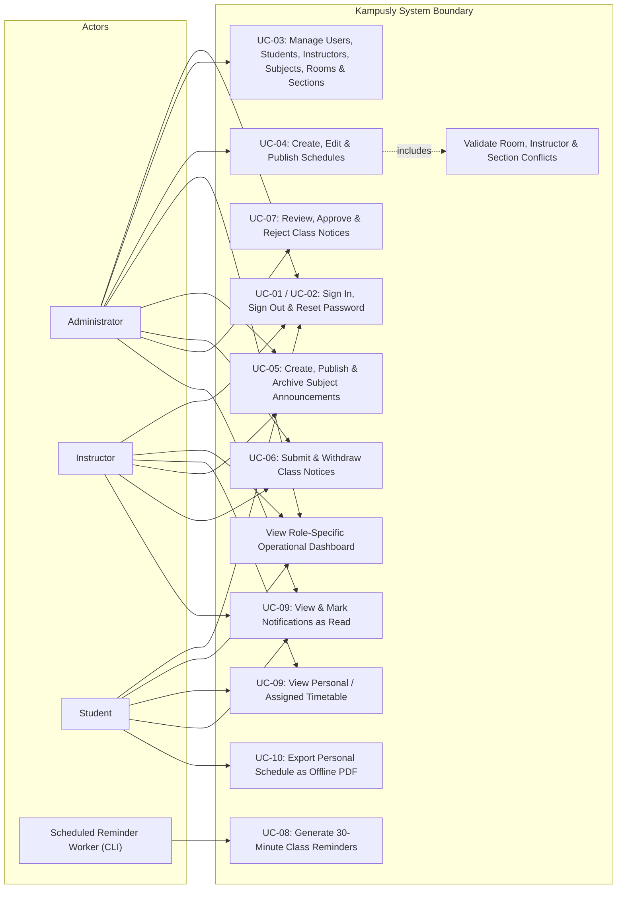

---

## 2. Activity Diagrams

### 2.1 Authentication and Role-Based Session Activity

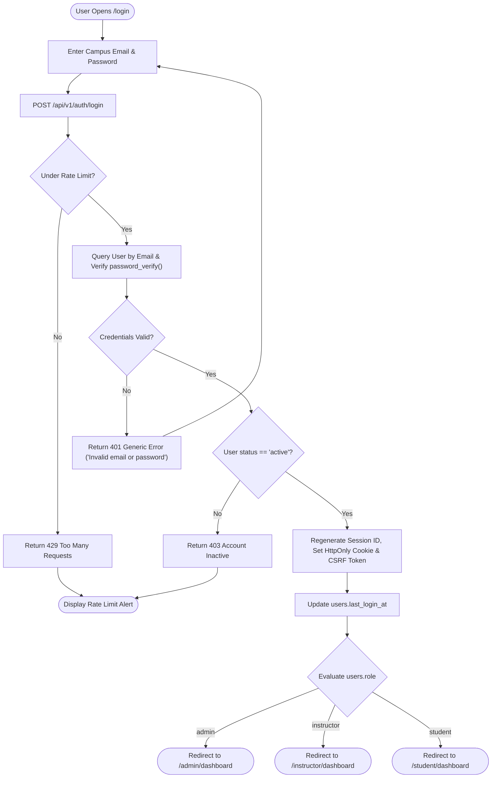

---

### 2.2 Schedule Creation, Conflict Detection, and Publication Activity

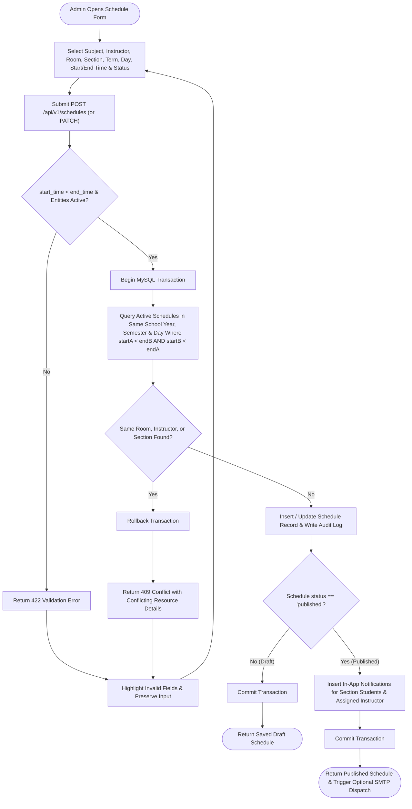

---

### 2.3 Class-Notice Submission and Hybrid Approval Activity

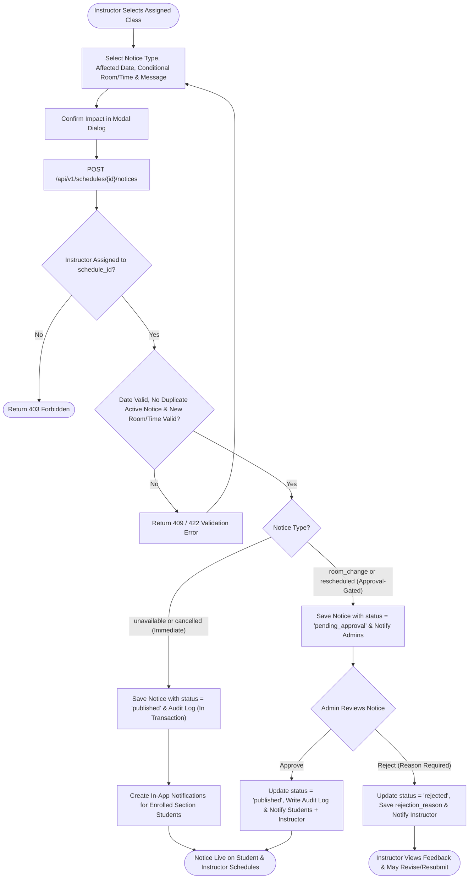

---

## 3. Sequence Diagrams

### 3.1 Schedule Creation and Conflict Validation Sequence

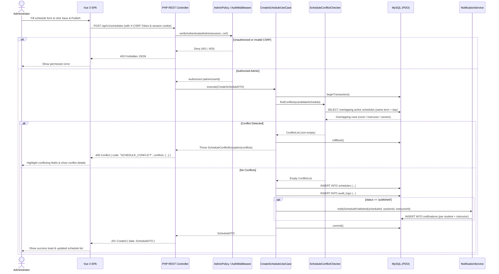

---

### 3.2 Class-Notice Submission, Approval, and Notification Sequence

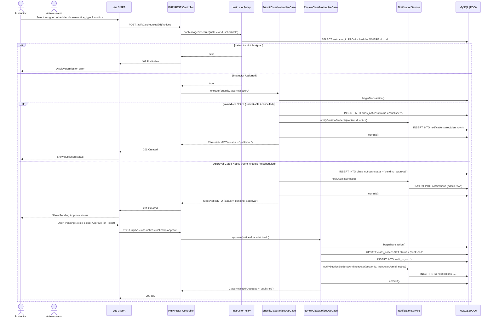

---

## 4. Component Diagram (Modular Monolith & SPA)

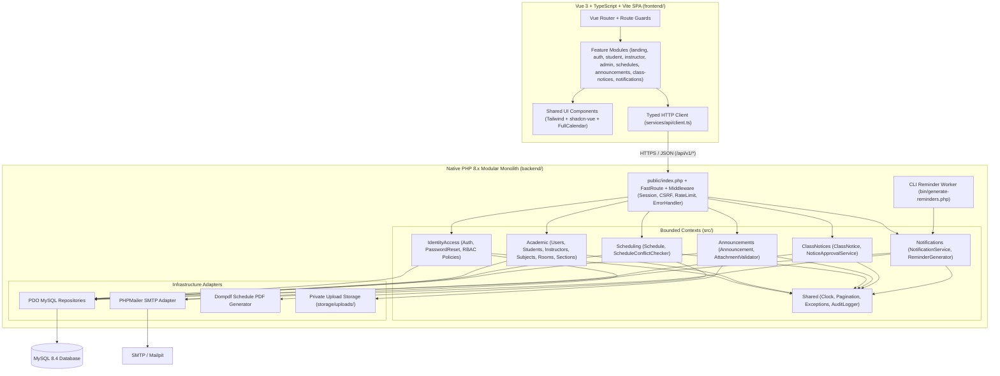

---

## 5. Deployment Diagram

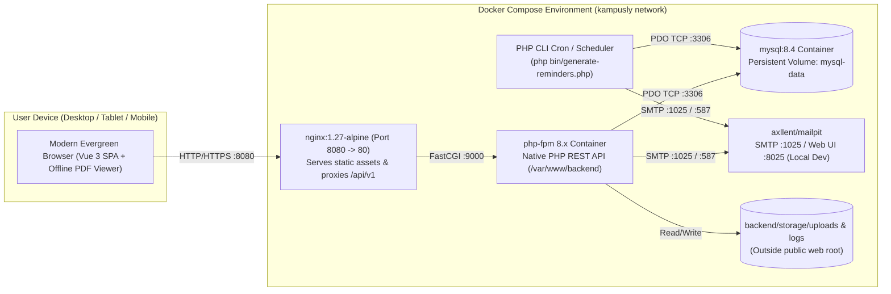

---

## 6. State Diagrams

### 6.1 Schedule Lifecycle State Diagram

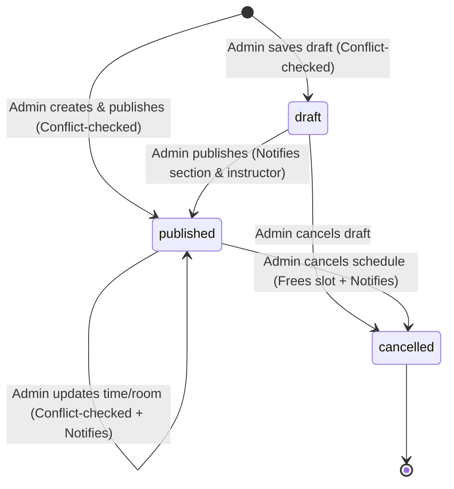

### 6.2 Announcement Lifecycle State Diagram

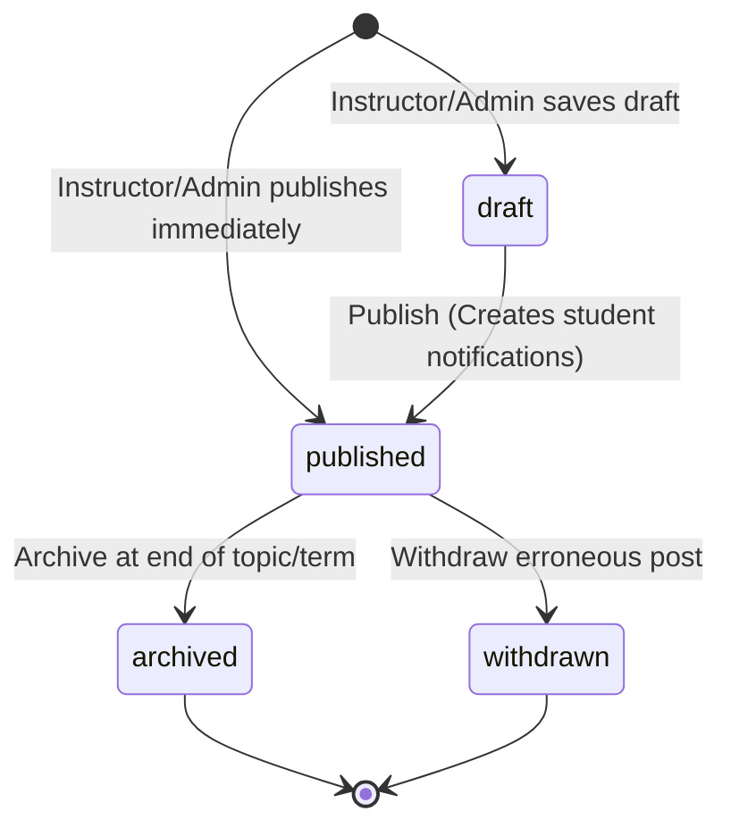

### 6.3 Class-Notice Lifecycle State Diagram

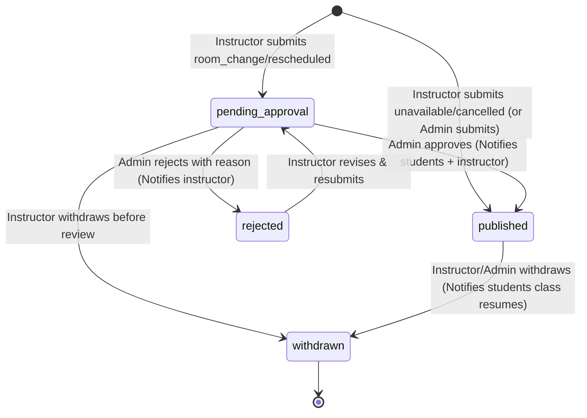

