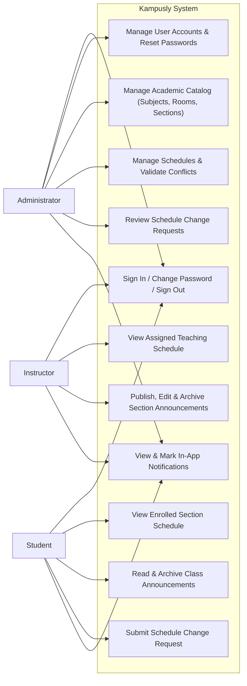
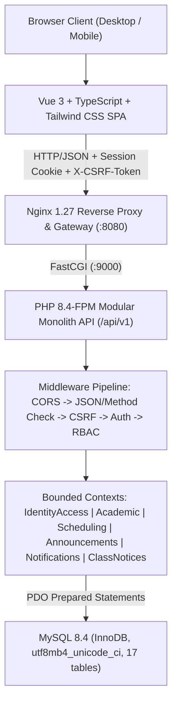
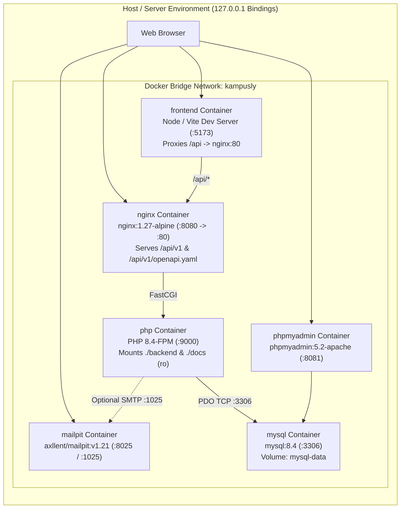
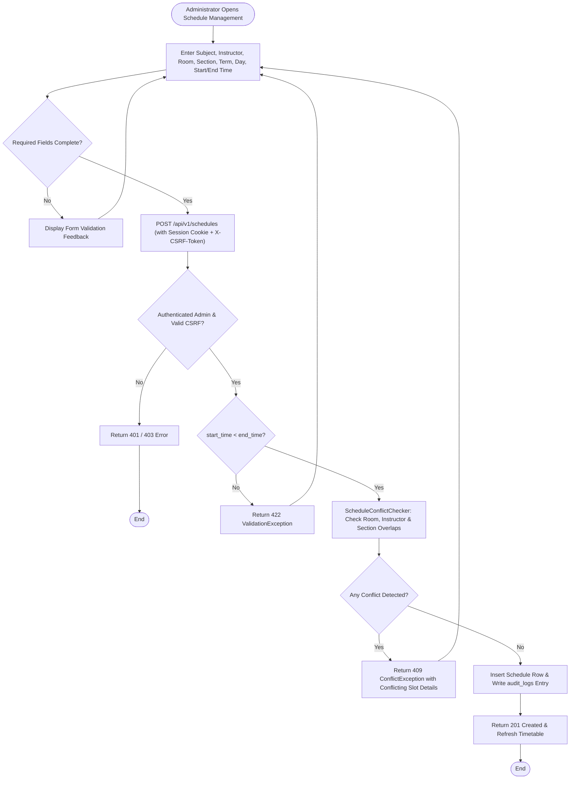
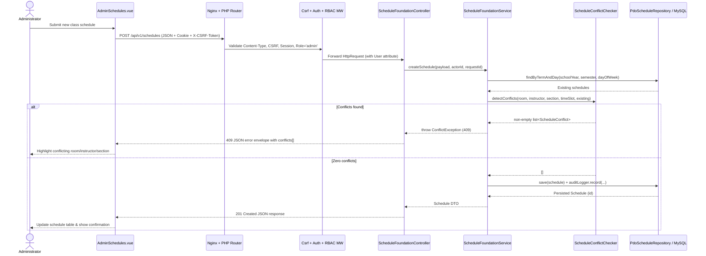
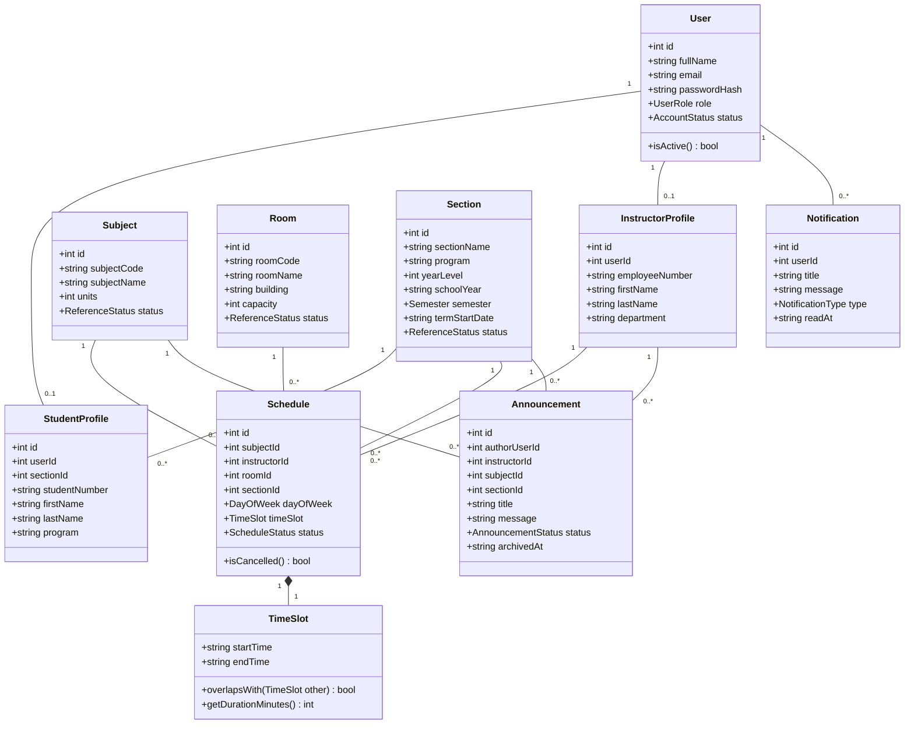
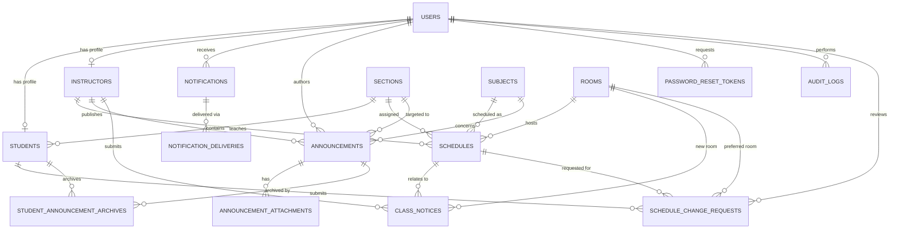

# KAMPUSLY

## A Web-Based Class Schedule Management and Notification System

*“Your Campus. Your Classes. Your Time.”*

---

# SYSTEM DOCUMENTATION

**Prepared by:**
- Kevin A. Quijano
- Jeril Mark P. Estinsu
- Stifany Mae L. Capuras

**Project Adviser:** Mr. Noel Lehitimas  
**Institution:** ACLC College Mandaue  
**Academic Year:** 2026–2027  
**Document Status:** Finalized & Verified Against Repository Implementation (November 2026)

---

## PRELIMINARY PAGES

### A. Approval and Signature Sheet

This project documentation entitled **“Kampusly: A Web-Based Class Schedule Management and Notification System,”** prepared and submitted by **Kevin A. Quijano**, **Jeril Mark P. Estinsu**, and **Stifany Mae L. Capuras**, is submitted to ACLC College Mandaue for review and approval.

| Approval Role | Printed Name / Signature | Date |
| :--- | :--- | :--- |
| Project Adviser | Mr. Noel Lehitimas / ________________________ | ____________ |
| Panel Member | ____________________________________________ | ____________ |
| Panel Member | ____________________________________________ | ____________ |
| Program Chair / Instructor | ____________________________________________ | ____________ |

---

### B. Abstract and Project Goals

Kampusly is a web-based class schedule management and notification system developed to centralize academic timetable management, role-scoped class announcements, schedule change requests, and in-app notifications for ACLC College Mandaue. The system serves three primary user roles—**Administrator**, **Instructor**, and **Student**—within a unified web platform that replaces fragmented manual spreadsheets and scattered messaging channels.

Administrators manage user accounts, student and instructor profiles, subjects, rooms, sections, and recurring weekly schedules with automated server-side double-booking conflict validation across rooms, instructors, and sections, while also reviewing student-submitted schedule change requests. Instructors access their assigned teaching schedules and publish formatted section-and-subject announcements that automatically dispatch in-app notifications to enrolled students. Students view their personal section timetable, read and archive class announcements, track real-time in-app notifications, and submit schedule change requests within configured academic term windows.

Kampusly is engineered as a **modular monolith** backed by a **Vue 3 + TypeScript + Tailwind CSS** single-page application, a **native PHP 8.4 (PSR-4, zero-framework) REST API** served through **Nginx and PHP-FPM**, and a normalized **MySQL 8.4 (`InnoDB`, `utf8mb4_unicode_ci`)** relational database with 16 application tables (plus `schema_migrations`), orchestrated via **Docker Compose**. Security controls—including HTTP-only session cookies, CSRF token validation, login rate limiting, role-based access control (RBAC), strict JSON content-type validation, parameterized PDO queries, and audit logging—are verified through **88 backend automated tests (324 assertions)**, **13 frontend unit tests**, and **61 live end-to-end HTTP checks**.

---

### C. Table of Contents, List of Figures, and List of Tables

#### Table of Contents

| Section | Page |
| :--- | :---: |
| **PRELIMINARY PAGES** | **2** |
| A. Approval and Signature Sheet | 2 |
| B. Abstract and Project Goals | 2 |
| C. Table of Contents, List of Figures, and List of Tables | 3 |
| **CHAPTER 1: INTRODUCTION AND PROJECT PLAN** | **7** |
| 1.1 Background of the Study | 7 |
| 1.2 Statement of the Problem | 7 |
| 1.3 Objectives | 7 |
| &nbsp;&nbsp;&nbsp;&nbsp;General Objective | 7 |
| &nbsp;&nbsp;&nbsp;&nbsp;Specific Objectives | 8 |
| 1.4 Scope and Limitations | 8 |
| &nbsp;&nbsp;&nbsp;&nbsp;Implemented Scope (Current Release — Verified) | 8 |
| &nbsp;&nbsp;&nbsp;&nbsp;Schema-Provisioned & Future Release Items (Not Yet Exposed in End-User UI) | 9 |
| &nbsp;&nbsp;&nbsp;&nbsp;Operational Dependencies | 9 |
| 1.5 Software Project Management Plan (SPMP) | 9 |
| **CHAPTER 2: SYSTEM ANALYSIS AND REQUIREMENTS (SRS)** | **11** |
| 2.1 Stakeholder Analysis and User Personas | 11 |
| 2.2 Functional Requirements | 11 |
| &nbsp;&nbsp;&nbsp;&nbsp;Identity & Access Requirements | 11 |
| &nbsp;&nbsp;&nbsp;&nbsp;Administrator Requirements | 12 |
| &nbsp;&nbsp;&nbsp;&nbsp;Instructor Requirements | 12 |
| &nbsp;&nbsp;&nbsp;&nbsp;Student Requirements | 12 |
| &nbsp;&nbsp;&nbsp;&nbsp;Notification Requirements | 12 |
| 2.3 Non-Functional Requirements | 13 |
| 2.4 Use Case Diagram and Specifications | 14 |
| &nbsp;&nbsp;&nbsp;&nbsp;Use Case Specification 1: Manage Schedule (Create / Update with Conflict Validation) | 14 |
| &nbsp;&nbsp;&nbsp;&nbsp;Use Case Specification 2: Submit & Review Schedule Change Request | 15 |
| **CHAPTER 3: SYSTEM DESIGN AND ARCHITECTURE (SDD)** | **17** |
| 3.1 System Architecture | 17 |
| 3.2 Deployment Diagram | 18 |
| 3.3 Unified Modeling Language (UML) Diagrams | 18 |
| &nbsp;&nbsp;&nbsp;&nbsp;Activity Diagram: Schedule Creation & Conflict Validation | 18 |
| &nbsp;&nbsp;&nbsp;&nbsp;Sequence Diagram: Authenticated Request with Conflict Validation | 18 |
| &nbsp;&nbsp;&nbsp;&nbsp;Class Diagram (Core Implemented Domain Entities) | 19 |
| 3.4 User Interface Architecture & Screen Inventory | 21 |
| **CHAPTER 4: DATABASE DESIGN AND DATA MODELS** | **23** |
| 4.1 Entity-Relationship Diagram (ERD) | 23 |
| 4.2 Data Dictionary / Physical Schema Table Definitions | 23 |
| &nbsp;&nbsp;&nbsp;&nbsp;1. `users` | 23 |
| &nbsp;&nbsp;&nbsp;&nbsp;2. `sections` | 24 |
| &nbsp;&nbsp;&nbsp;&nbsp;3. `students` | 25 |
| &nbsp;&nbsp;&nbsp;&nbsp;4. `instructors` | 25 |
| &nbsp;&nbsp;&nbsp;&nbsp;5. `subjects` | 25 |
| &nbsp;&nbsp;&nbsp;&nbsp;6. `rooms` | 26 |
| &nbsp;&nbsp;&nbsp;&nbsp;7. `schedules` | 26 |
| &nbsp;&nbsp;&nbsp;&nbsp;8. `schedule_change_requests` | 27 |
| &nbsp;&nbsp;&nbsp;&nbsp;9. `announcements`, `student_announcement_archives`, and `announcement_attachments` | 28 |
| &nbsp;&nbsp;&nbsp;&nbsp;10. `notifications` and `notification_deliveries` | 28 |
| &nbsp;&nbsp;&nbsp;&nbsp;11. Supporting Governance & Provisioned Tables | 28 |
| 4.3 Normalization Analysis (Verified) | 29 |
| **CHAPTER 5: IMPLEMENTATION AND CODE STRUCTURE** | **30** |
| 5.1 Verified Technology Stack | 30 |
| 5.2 Key Algorithms and Verified Core Module Snippets | 31 |
| &nbsp;&nbsp;&nbsp;&nbsp;1. Half-Open Time Interval Overlap (`TimeSlot.php`) | 31 |
| &nbsp;&nbsp;&nbsp;&nbsp;2. Multi-Dimension Schedule Conflict Detection (`ScheduleConflictChecker.php`) | 31 |
| &nbsp;&nbsp;&nbsp;&nbsp;3. Student Schedule Change Window Rule (`ScheduleChangeWindow.php`) | 32 |
| &nbsp;&nbsp;&nbsp;&nbsp;4. Global CSRF Protection Middleware (`CsrfMiddleware.php`) | 32 |
| 5.3 System Verification Summary & GUI Walkthrough | 32 |
| &nbsp;&nbsp;&nbsp;&nbsp;Automated & Live Verification Results (Verified November 21, 2026) | 32 |
| &nbsp;&nbsp;&nbsp;&nbsp;GUI Walkthrough Checklist (Screenshots to Insert in Final Bound Copy) | 33 |
| **APPENDICES & REFERENCES** | **35** |
| Appendix A. Verified REST API Route Inventory (`backend/routes/api.php`) | 35 |
| Appendix B. User Manuals | 36 |
| &nbsp;&nbsp;&nbsp;&nbsp;B.1 Student User Manual | 36 |
| &nbsp;&nbsp;&nbsp;&nbsp;B.2 Instructor User Manual | 37 |
| &nbsp;&nbsp;&nbsp;&nbsp;B.3 Administrator User Manual | 37 |
| Appendix C. Certificates and Turnover Logs | 37 |
| Appendix D. References (APA 7th Edition) | 38 |

#### List of Figures

| Figure | Title | Page |
| :---: | :--- | :---: |
| **Figure 1** | Kampusly System Use Case Diagram | 14 |
| **Figure 2** | Kampusly Modular Monolith System Architecture Diagram | 17 |
| **Figure 3** | Kampusly Docker Compose Deployment Diagram | 18 |
| **Figure 4** | Activity Diagram — Schedule Creation and Conflict Validation | 18 |
| **Figure 5** | Sequence Diagram — Authenticated Schedule Creation with Conflict Validation | 19 |
| **Figure 6** | Class Diagram — Core Implemented Domain Entities | 21 |
| **Figure 7** | Kampusly Physical Entity-Relationship Diagram (ERD) | 23 |

#### List of Tables

| Table | Title | Page |
| :---: | :--- | :---: |
| **Table 1** | Approval and Signature Sheet | 2 |
| **Table 2** | Software Project Management Plan (SPMP) Milestones and Verification Evidence | 9 |
| **Table 3** | Stakeholder Analysis and User Personas | 11 |
| **Table 4** | Non-Functional Requirements and Verified Implementations | 13 |
| **Table 5** | Use Case Specification 1 — Manage Schedule (Create / Update with Conflict Validation) | 14 |
| **Table 6** | Use Case Specification 2 — Submit and Review Schedule Change Request | 15 |
| **Table 7** | User Interface Architecture and Screen Inventory | 21 |
| **Table 8** | Data Dictionary — `users` Table | 23 |
| **Table 9** | Data Dictionary — `sections` Table | 24 |
| **Table 10** | Data Dictionary — `students` Table | 25 |
| **Table 11** | Data Dictionary — `instructors` Table | 25 |
| **Table 12** | Data Dictionary — `subjects` Table | 25 |
| **Table 13** | Data Dictionary — `rooms` Table | 26 |
| **Table 14** | Data Dictionary — `schedules` Table | 26 |
| **Table 15** | Data Dictionary — `schedule_change_requests` Table | 27 |
| **Table 16** | Verified Technology Stack (Planning Baseline vs. Repository Implementation) | 30 |
| **Table 17** | Automated and Live System Verification Results | 32 |
| **Table 18** | GUI Walkthrough Checklist | 33 |
| **Table 19** | Verified REST API Route and Access Control Inventory | 35 |
| **Table 20** | System Turnover Checklist and Logs | 37 |

---

## CHAPTER 1: INTRODUCTION AND PROJECT PLAN

### 1.1 Background of the Study

Class schedules form the operational backbone of daily academic life for students, faculty members, and school administrators. Students depend on accurate, up-to-date details regarding their enrolled subjects, meeting days, time slots, assigned rooms, and instructors. Instructors require a clear view of their teaching load and a reliable channel to communicate section-specific updates. Administrators must coordinate rooms, faculty loads, and student cohorts without introducing overlapping schedules.

When schedule records and class updates are maintained across separate spreadsheets, bulletin boards, or informal group chats, conflicting room bookings, outdated timetables, and missed announcements become common. **Kampusly** addresses these challenges through a centralized, role-based web application that enforces schedule integrity at the database and application layers while delivering timely in-app updates directly to affected users.

### 1.2 Statement of the Problem

1. **Fragmented Schedule Sources:** Students frequently consult multiple channels to verify class times, assigned rooms, instructors, and schedule updates, increasing the risk of relying on outdated information.
2. **Unstructured Class Communication:** Instructors lack a centralized, permission-controlled mechanism to deliver formatted announcements exclusively to students enrolled in their assigned sections and subjects.
3. **Manual Record & Conflict Management:** Administrators managing students, instructors, subjects, rooms, sections, and timetables manually face a high risk of double-booking rooms, instructors, or student sections.
4. **Lack of Structured Schedule Change Tracking:** Without a controlled request workflow tied to academic term windows, student requests for schedule adjustments are difficult to track, audit, and validate against conflicts.
5. **Overlooked Updates:** Important academic notices and schedule decisions are easily missed when there is no centralized in-app notification center tracking unread updates per user.

### 1.3 Objectives

#### General Objective
To design, develop, test, and document **Kampusly**, a web-based class schedule management and notification system that centralizes academic record administration, conflict-free scheduling, class announcements, schedule change workflows, and in-app notifications for administrators, instructors, and students.

#### Specific Objectives
1. Provide role-based authentication and administrative tools for maintaining user accounts, student and instructor profiles, subjects, rooms, sections, and recurring weekly class schedules.
2. Implement deterministic server-side schedule conflict detection that blocks overlapping room, instructor, and section assignments within the same academic term and day of week.
3. Enable students to view their personal enrolled section schedules, read and archive class announcements, track in-app notifications, and submit schedule change requests within active term windows.
4. Enable instructors to view their assigned teaching schedules and publish, edit, archive, and restore formatted announcements scoped strictly to their assigned section-subject combinations.
5. Provide a per-user in-app notification center with independent read/unread state tracking and automatic notification dispatch on announcements and schedule change decisions.
6. Enforce strict security, data integrity, and maintainability standards through server-side RBAC, CSRF protection, rate limiting, audit logging, normalized relational design, OpenAPI 3.1 documentation, and automated testing.

### 1.4 Scope and Limitations

#### Implemented Scope (Current Release — Verified)
- **Authentication & Access Control:** Email/password login, HTTP-only session cookies, session regeneration on login, login rate limiting (5 attempts per 60 seconds per IP + email), self-service password change, admin-triggered password resets, CSRF protection (`X-CSRF-Token`), strict JSON content-type validation, and three-role RBAC (`admin`, `instructor`, `student`).
- **Administrator Portal:** Live KPI summary dashboard, user account management (create with one-time generated credentials, filter, activate/deactivate, reset password), academic catalog CRUD (subjects, rooms, sections with `term_start_date` and student roster modal), schedule management with real-time conflict pre-check and publish/cancel lifecycle, and schedule change request review panel.
- **Instructor Portal:** Faculty profile card, filterable teaching schedule (by day and section), rich-text announcement composer (`RichTextEditor` with safe custom markup tags) scoped strictly to assigned sections and subjects, announcement editing, and 7-day soft archiving/restoration.
- **Student Portal:** Student profile card, collapsible day-grouped enrolled section schedule, class announcement feed with personal 7-day archive/restore capability, and term-window-gated schedule change request submission and status tracking.
- **In-App Notification Center:** Header popover available across all portals with unread badge counter, mark-single-as-read, mark-all-as-read, outside-click/Escape dismissal, and light/dark theme toggle.
- **API Documentation & Infrastructure:** OpenAPI 3.1.0 specification (`/api/v1/openapi.yaml`), Swagger UI (`/api/v1/docs`), `/health/live` and `/health/ready` diagnostics, and containerized Docker Compose deployment (`nginx`, `php`, `mysql`, `frontend`, `phpmyadmin`, `mailpit`).

#### Schema-Provisioned & Future Release Items (Not Yet Exposed in End-User UI)
To maintain accurate engineering transparency, the following items have database schemas and/or backend domain foundations provisioned in the repository but are deferred to subsequent releases:
- **Class Notices (`class_notices`):** Database schema (`migration 000400`) and backend domain/repository/service foundation (`ClassNoticeFoundationService`) exist; HTTP endpoints and UI workflows are planned for the next iteration.
- **Automated 30-Minute Pre-Class Reminders & SMTP Email Delivery:** `notifications.deduplication_key`, `notification_deliveries`, and the local Mailpit container are provisioned; the background cron worker and PHPMailer SMTP dispatch integration are planned.
- **Schedule PDF Export:** Deferred to a future release (not implemented in the current build).
- **Announcement File Attachments & Email Self-Service Password Reset:** `announcement_attachments` and `password_reset_tokens` tables are provisioned in MySQL; upload endpoints and email token reset flows are planned.
- **Deferred Enhancements:** Browser Web Push, WebSockets, Redis job queues, multi-campus tenancy, Terraform IaC, and advanced analytics are outside the current release scope.

#### Operational Dependencies
System availability depends on accurate institutional seed/catalog data maintained by administrators, a functioning LAMP/Docker hosting environment (Nginx, PHP 8.2+, MySQL 8.4), and reliable client internet/LAN connectivity.

### 1.5 Software Project Management Plan (SPMP)

Kampusly was developed using an iterative, milestone-driven workflow aligned with repository phases:

| Milestone | Scope Completed | Status | Verification Evidence |
| :--- | :--- | :---: | :--- |
| **M1 – Project Setup** | Repository structure, `.env` templates, Docker Compose stack (`nginx`, `php`, `mysql`, `frontend`, `phpmyadmin`, `mailpit`), Git governance (`CONTRIBUTING.md`, `SECURITY.md`) | **Completed** | `docker-compose.yml`, `docker compose config -q`, running healthy containers |
| **M2 – Application Foundation** | Native PHP front controller, custom PSR-4 router, DI container, PDO connection factory, error handler, migration runner, Vue 3 + Vite + Tailwind CSS shell | **Completed** | `backend/src/Bootstrap/`, `frontend/src/app/`, `/api/v1/health/live` & `/health/ready` |
| **M3 – Identity & Academic Data** | Session auth, CSRF, rate limiter, RBAC middleware, audit logging, user administration, student/instructor/subject/room/section CRUD & rosters | **Completed** | 9/9 MySQL migrations applied; RBAC & Academic feature tests passing |
| **M4 – Scheduling & Change Requests** | Recurring schedules CRUD, room/instructor/section half-open interval conflict validation, role-scoped schedule views, student schedule change request workflow | **Completed** | `ScheduleConflictChecker`, `ScheduleChangeWindow`, live API tests |
| **M5 – Communication & Notifications** | Instructor rich-text announcements, per-student & instructor 7-day archiving, per-user in-app notifications (`unread_count`, mark read / read-all) | **Completed** | `InstructorAnnouncementService`, `NotificationController`, `NotificationCenter.vue` |
| **M6 – Finalization, Audit & QA** | UI/UX dark & light theme polish, OpenAPI 3.1 / Swagger UI serving fix, security RBAC hardening audit, documentation finalization | **Completed** | 88 backend tests (324 assertions), 13 frontend tests, 61/61 live E2E checks |

---

## CHAPTER 2: SYSTEM ANALYSIS AND REQUIREMENTS (SRS)

### 2.1 Stakeholder Analysis and User Personas

| Stakeholder / Persona | Core Responsibilities & System Needs | Access Boundaries |
| :--- | :--- | :--- |
| **Administrator** | Maintains user accounts (create, activate/deactivate, reset passwords), academic catalog (subjects, rooms, sections, term start dates), weekly class schedules, and reviews student schedule change requests. Needs deterministic conflict detection and audit trails. | Full administrative API & UI access; cannot access student-only or instructor-only personal portal endpoints (`403 Forbidden`). |
| **Instructor** | Views personal assigned teaching schedule filtered by day and section; publishes, edits, archives, and restores section-and-subject announcements; monitors notifications. | Restricted to schedules assigned to their `instructor_id` and announcements for their assigned `(section_id, subject_id)` pairs; blocked from admin endpoints and instructor directory enumeration (`403`). |
| **Student** | Views personal enrolled section timetable grouped by day; reads and archives class announcements; submits and tracks schedule change requests during the open term window; reviews personal notifications. | Strictly scoped to their `section_id` and `student_id`; blocked from admin/instructor endpoints, user lists, student directory, instructor directory, and other sections' rosters (`403`). |

### 2.2 Functional Requirements

#### Identity & Access Requirements
- **FR-AUTH-01:** Users shall sign in with institutional email and password via `POST /api/v1/auth/login`, receiving an HTTP-only session cookie and an in-memory CSRF token.
- **FR-AUTH-02:** Inactive accounts (`status = 'inactive'`) shall be blocked from authenticating (`403 ACCOUNT_INACTIVE`) and from holding active sessions.
- **FR-AUTH-03:** Login attempts shall be rate-limited to 5 failed attempts per 60 seconds per client IP and email combination (`429`).
- **FR-AUTH-04:** Authenticated users shall be able to inspect their active session (`GET /api/v1/auth/me`), change their own password (`POST /api/v1/auth/change-password`), and securely terminate their session (`POST /api/v1/auth/logout`, returning `204 No Content`).

#### Administrator Requirements
- **FR-ADM-01:** Administrators shall view real-time institutional KPIs (`GET /api/v1/admin/dashboard-summary`) including user counts, active subjects, rooms, sections, and classes scheduled for today.
- **FR-ADM-02:** Administrators shall list, filter, create (with secure one-time generated passwords), activate/deactivate, and reset passwords for user accounts (`/api/v1/users*`), with every sensitive action logged to `audit_logs`.
- **FR-ADM-03:** Administrators shall perform CRUD operations on students, instructors, subjects, rooms, and sections (including setting `term_start_date` and viewing enrolled students per section), while blocking deletion of catalog records referenced by schedules (`409`).
- **FR-ADM-04:** Administrators shall create, edit, publish, and cancel recurring weekly schedules (`/api/v1/schedules*`) with both pre-save validation (`POST /api/v1/schedules/validate-conflicts`) and persistence-time conflict blocking across room, instructor, and section dimensions.
- **FR-ADM-05:** Administrators shall list and review student schedule change requests (`GET /api/v1/schedule-change-requests`, `PATCH /api/v1/schedule-change-requests/{id}`), approving or rejecting requests with optional review notes and automatic student notification.

#### Instructor Requirements
- **FR-INS-01:** Instructors shall view only published/assigned teaching schedules linked to their instructor profile (`GET /api/v1/instructor/schedule`), with day and section filters.
- **FR-INS-02:** Instructors shall create, edit, archive, and restore formatted announcements (`GET/POST /api/v1/instructor/announcements`, `PUT /api/v1/instructor/announcements/{id}`, `POST/DELETE /api/v1/instructor/announcements/{id}/archive`) restricted exclusively to their assigned section-and-subject pairs.
- **FR-INS-03:** Publishing or updating an announcement shall automatically notify all active students enrolled in the targeted section.

#### Student Requirements
- **FR-STU-01:** Students shall view their enrolled section's published class schedule (`GET /api/v1/student/schedule`) showing subject code, subject name, day, time range, room, building, and instructor.
- **FR-STU-02:** Students shall read section-relevant announcements (`GET /api/v1/student/announcements`) and archive or restore items independently (`POST/DELETE /api/v1/student/announcements/{id}/archive`) without affecting other students.
- **FR-STU-03:** Students shall view their section's schedule change window status and submit or track schedule change requests (`GET/POST /api/v1/student/schedule-change-requests`) when the 1-month window from `term_start_date` is open, limited to one pending request per scheduled class.

#### Notification Requirements
- **FR-NOTIF-01:** Every authenticated user shall retrieve their paginated notifications and live unread count (`GET /api/v1/notifications`, supporting `unread_only=true|false`).
- **FR-NOTIF-02:** Each recipient shall maintain an independent `read_at` state and be able to mark an individual notification as read (`PATCH /api/v1/notifications/{id}/read`) or mark all unread notifications as read (`POST /api/v1/notifications/read-all`).
- **FR-NOTIF-03 (Schema-Provisioned / Planned):** Automated 30-minute pre-class reminder dispatch and optional SMTP email delivery are supported structurally via `notifications.deduplication_key` and `notification_deliveries` for future scheduler integration.

### 2.3 Non-Functional Requirements

| Category | Verified Implementation in Kampusly |
| :--- | :--- |
| **Security** | Server-side session auth (`AuthenticateMiddleware`), role RBAC (`AuthorizeRoleMiddleware`), global CSRF verification (`CsrfMiddleware`), strict JSON `Content-Type` enforcement (`415`), Bcrypt/Argon2 password hashing with auto-rehash, session ID regeneration, login rate limiting (`5/60s`), PDO prepared statements, custom safe announcement markup renderer (no raw HTML injection), and `audit_logs` tracking. |
| **Reliability & Data Integrity** | Half-open interval conflict checking (`max(S1,S2) < min(E1,E2)`), MySQL `CHECK` constraints (`start_time < end_time`), `UNIQUE` constraints, stored generated column preventing duplicate pending schedule change requests, transactional multi-table writes (`PdoTransactionManager`), and `ON DELETE RESTRICT` preventing orphaned academic records. |
| **Usability & Accessibility** | Responsive Vue 3 + Tailwind CSS interface with light/dark theme toggle, semantic ARIA labels, keyboard-accessible popovers (`Escape` / outside-click dismissal), consistent modal layouts, readable typography scale, and clear loading/empty/error states. |
| **Maintainability** | Modular monolith organized into domain bounded contexts (`IdentityAccess`, `Academic`, `Scheduling`, `Announcements`, `ClassNotices`, `Notifications`, `Shared`), clean layered folders (`Domain`, `Application`, `Infrastructure`, `Presentation`), PSR-4 autoloading, and strict TypeScript typing (`vue-tsc -b`). |
| **Performance** | Composite MySQL indexes tailored to conflict lookups (`idx_schedules_room_conflict`, `idx_schedules_instructor_conflict`, `idx_schedules_section_conflict`), unread notification feeds (`idx_notifications_user_unread`), server-side pagination (`PaginationQuery`), and route-level lazy chunk splitting in Vite. |
| **Testability & Observability** | Automated `composer check` (syntax lint, PSR-12 style, static analysis across 114 classes, 88 automated tests / 324 assertions), frontend `lint` + `test` + `build`, structured `X-Request-Id` correlation headers, OpenAPI 3.1 live spec, and `/health/live` + `/health/ready` probes. |

### 2.4 Use Case Diagram and Specifications



#### Use Case Specification 1: Manage Schedule (Create / Update with Conflict Validation)

| Field | Specification |
| :--- | :--- |
| **Primary Actor** | Administrator |
| **Preconditions** | Administrator is authenticated with a valid session cookie and CSRF token; at least one active subject, instructor, room, and section exist. |
| **Main Flow** | 1. Administrator opens **Schedule Management** (`/admin/schedules`).<br>2. Selects section, subject, instructor, room, day of week, start/end time, academic term, and status (`draft` or `published`).<br>3. Frontend optionally invokes `POST /api/v1/schedules/validate-conflicts` for immediate conflict preview.<br>4. Administrator submits the form (`POST /api/v1/schedules` or `PATCH /api/v1/schedules/{id}`).<br>5. Backend validates inputs (`TimeSlot` enforces `start_time < end_time`), loads existing non-cancelled schedules for the same term/day, and executes `ScheduleConflictChecker::detectConflicts()`.<br>6. When zero conflicts exist, the schedule is persisted in MySQL, logged in `audit_logs`, and returned (`201`/`200`). |
| **Alternative Flow** | If `start_time >= end_time` or fields are invalid, backend returns `422 ValidationException`. If any room, instructor, or section time overlap is detected, backend rejects the mutation with `409 ConflictException` detailing every conflicting dimension and existing class slot. |
| **Postcondition** | A conflict-free schedule record is saved; published entries immediately appear in the assigned instructor's and enrolled students' portals. |

#### Use Case Specification 2: Submit & Review Schedule Change Request

| Field | Specification |
| :--- | :--- |
| **Primary Actor** | Student (submission), Administrator (review) |
| **Preconditions** | Student belongs to an active section with `term_start_date` configured; current date falls within the 1-month `ScheduleChangeWindow`; student has no existing `pending` request for the target `schedule_id`. |
| **Main Flow** | 1. Student expands **Schedule Change Request** on the Student Dashboard, selects a class, enters preferred day/time/room and reason, and submits (`POST /api/v1/student/schedule-change-requests`).<br>2. Backend validates window openness, schedule ownership, and uniqueness (`uq_schedule_change_requests_one_pending`), creating a `pending` record.<br>3. Administrator opens the **Schedule Change Requests** panel, inspects the request, and submits an `approved` or `rejected` decision with an optional review note (`PATCH /api/v1/schedule-change-requests/{id}`).<br>4. Backend updates the request status, applies approved schedule adjustments (after conflict re-validation) if requested, writes an audit log, and inserts an in-app notification for the student. |
| **Alternative Flow** | If `term_start_date` is unset or the 1-month deadline has passed, the UI shows **Closed** and the backend rejects submissions (`422`). Duplicate pending requests for the same class are rejected (`409`). |
| **Postcondition** | Request status is finalized (`approved` or `rejected`) and the student is notified in-app. |

---

## CHAPTER 3: SYSTEM DESIGN AND ARCHITECTURE (SDD)

### 3.1 System Architecture

Kampusly implements a **Modular Monolith** architecture inspired by Domain-Driven Design (DDD). Rather than splitting into prematurely complex microservices, all backend capabilities run within one cohesive native PHP application strictly partitioned into seven bounded contexts under `backend/src/`:

1. **`IdentityAccess`** — Authentication, password hashing, session/CSRF lifecycle, user administration, RBAC policies (`AdminPolicy`, `InstructorPolicy`, `StudentPolicy`), and admin KPI summary.
2. **`Academic`** — Student profiles, instructor profiles, subjects, rooms, and sections catalog CRUD and enrollment rosters.
3. **`Scheduling`** — Recurring weekly schedules, `TimeSlot` & `ScheduleConflictChecker` domain engine, role-scoped schedule queries, and `ScheduleChangeWindow` + `ScheduleChangeRequestService`.
4. **`Announcements`** — Instructor announcements, safe `AnnouncementMarkup` plain-text parser, and dual-sided (instructor + per-student) 7-day archiving.
5. **`ClassNotices`** — Domain entities, value objects, PDO persistence, and foundation service for date-specific class notices (provisioned for next release).
6. **`Notifications`** — Per-user notification storage, unread counter, and read/read-all state management.
7. **`Shared`** — HTTP request/response abstractions, middleware (`AuthenticateMiddleware`, `AuthorizeRoleMiddleware`, `CsrfMiddleware`, `CorsMiddleware`), `RateLimiter`, `RequestValidator`, `PdoConnectionFactory`, `PdoTransactionManager`, `MigrationRunner`, `PdoAuditLogger`, `HealthCheckService`, and `OpenApiDocumentationController`.



The frontend never connects directly to MySQL. All reads and writes traverse the versioned REST API (`/api/v1/*`) through `frontend/src/services/api/client.ts`, which automatically attaches `credentials: 'include'`, `Accept: application/json`, `Content-Type: application/json`, and `X-CSRF-Token` on mutating requests (`POST`, `PUT`, `PATCH`, `DELETE`).

### 3.2 Deployment Diagram

All runtime services are containerized in `docker-compose.yml` on an isolated Docker bridge network (`kampusly`) with all host port bindings restricted to `127.0.0.1` for local development security:



### 3.3 Unified Modeling Language (UML) Diagrams

#### Activity Diagram: Schedule Creation & Conflict Validation



#### Sequence Diagram: Authenticated Request with Conflict Validation



#### Class Diagram (Core Implemented Domain Entities)



### 3.4 User Interface Architecture & Screen Inventory

Kampusly uses a custom Tailwind CSS design system (`frontend/tailwind.config.ts`, `frontend/src/assets/main.css`) supporting both **Light** and **Dark** themes with accessible contrast ratios, semantic design tokens (`canvas`, `surface`, `ink`, `muted`, `subtle`, `hairline`, `action`, `accent`, `navy`), and unified portal headers featuring a `NotificationCenter` popover, `ThemeToggle`, clickable `UserSessionPopover`, and icon-only logout control.

| Screen / Route | Vue Component | Role | Verified Functionality |
| :--- | :--- | :--- | :--- |
| **Landing Page** (`/`) | `LandingPage.vue` | Public | Product overview, role value propositions, and navigation to Sign In. |
| **Sign In** (`/login`) | `LoginPage.vue` | Guest | Email/password authentication, inline validation, error feedback, and automatic redirect to role dashboard. |
| **Admin Dashboard** (`/admin/dashboard`, `/admin/students`, `/admin/instructors`) | `AdminDashboard.vue` | Admin | KPI summary cards, searchable/filterable User Accounts table, Add User & One-Time Credentials modals, Reset Password / Deactivate actions, Active Subjects, and Classes Today widgets. |
| **Schedule Management** (`/admin/schedules`) | `AdminSchedules.vue`, `ScheduleChangeRequestsPanel.vue` | Admin | Section-based schedule builder with live conflict pre-validation, publish/edit/cancel actions, pagination, and Student Schedule Change Requests review queue. |
| **Subject / Room / Section Management** (`/admin/subjects`, `/admin/rooms`, `/admin/sections`) | `SubjectsView.vue`, `RoomsView.vue`, `SectionsView.vue` | Admin | Searchable, status-filterable, paginated catalog tables, standardized create/edit modals, `ConfirmDialog` deletion safeguards, and `SectionStudentsModal` roster viewer. |
| **Instructor Dashboard** (`/instructor/dashboard`) | `InstructorDashboard.vue`, `InstructorWorkPanel.vue` | Instructor | Faculty profile card, day/section-filterable teaching schedule, `RichTextEditor` announcement composer for assigned classes, edit/archive/restore announcement history. |
| **Student Dashboard** (`/student/dashboard`) | `StudentDashboard.vue` | Student | Student profile card, collapsible day-grouped enrolled section schedule, class announcements panel with personal 7-day archive/restore, and schedule change request panel with term-window status badge. |
| **Shared Header Controls** (all portals) | `NotificationCenter.vue`, `UserSessionPopover.vue`, `ThemeToggle.vue` | All Auth | Unread notification dropdown (mark read / read-all, outside-click & Escape dismiss), session profile & password-change popover, and persistent light/dark mode switch. |

---

## CHAPTER 4: DATABASE DESIGN AND DATA MODELS

### 4.1 Entity-Relationship Diagram (ERD)

The physical MySQL 8.4 schema (`InnoDB`, `utf8mb4`, `utf8mb4_unicode_ci`) consists of **16 application tables** plus `schema_migrations` (**17 tables total**), managed through 9 idempotent SQL migrations (`000000` through `000800`).



### 4.2 Data Dictionary / Physical Schema Table Definitions

All tables below are verified directly against `backend/database/migrations/` and the live MySQL 8.4 database (`docs/database/database-design.md`, v2.0).

#### 1. `users`
| Column | Type | Null | Key / Constraints |
| :--- | :--- | :---: | :--- |
| `id` | `BIGINT UNSIGNED` | NO | `PK`, `AUTO_INCREMENT` |
| `full_name` | `VARCHAR(150)` | NO | Display name synced with profile names |
| `email` | `VARCHAR(191)` | NO | `UNIQUE (uk_users_email)`, stored lowercase |
| `password_hash` | `VARCHAR(255)` | NO | Bcrypt / Argon2id hash |
| `role` | `ENUM('admin','instructor','student')` | NO | `INDEX idx_users_role_status (role, status)` |
| `status` | `ENUM('active','inactive')` | NO | Default `'active'` |
| `email_verified_at` | `DATETIME` | YES | Default `NULL` |
| `last_login_at` | `DATETIME` | YES | Updated on successful login |
| `created_at` / `updated_at` | `DATETIME` | NO | `CURRENT_TIMESTAMP` / `ON UPDATE CURRENT_TIMESTAMP` |

#### 2. `sections`
| Column | Type | Null | Key / Constraints |
| :--- | :--- | :---: | :--- |
| `id` | `BIGINT UNSIGNED` | NO | `PK`, `AUTO_INCREMENT` |
| `section_name` | `VARCHAR(80)` | NO | Part of `UNIQUE uq_sections_term_name (school_year, semester, section_name)` |
| `program` | `VARCHAR(120)` | NO | `INDEX idx_sections_program_year (program, year_level, status)` |
| `year_level` | `TINYINT UNSIGNED` | NO | Range `1`–`6` |
| `school_year` | `VARCHAR(20)` | NO | e.g., `'2026-2027'` |
| `semester` | `ENUM('1st','2nd','Summer')` | NO | Term semester |
| `term_start_date` | `DATE` | YES | Controls 1-month student schedule change window (`migration 000600`) |
| `status` | `ENUM('active','inactive')` | NO | Default `'active'` |
| `created_at` / `updated_at` | `DATETIME` | NO | Audit timestamps |

#### 3. `students`
| Column | Type | Null | Key / Constraints |
| :--- | :--- | :---: | :--- |
| `id` | `BIGINT UNSIGNED` | NO | `PK`, `AUTO_INCREMENT` |
| `user_id` | `BIGINT UNSIGNED` | NO | `UNIQUE`, `FK -> users(id) ON DELETE RESTRICT` |
| `section_id` | `BIGINT UNSIGNED` | NO | `INDEX`, `FK -> sections(id) ON DELETE RESTRICT` |
| `student_number` | `VARCHAR(50)` | NO | `UNIQUE (uk_students_student_number)` |
| `first_name` / `last_name` | `VARCHAR(80)` | NO | `INDEX idx_students_name (last_name, first_name)` |
| `program` | `VARCHAR(120)` | NO | Enrolled degree program |
| `created_at` / `updated_at` | `DATETIME` | NO | Audit timestamps |

#### 4. `instructors`
| Column | Type | Null | Key / Constraints |
| :--- | :--- | :---: | :--- |
| `id` | `BIGINT UNSIGNED` | NO | `PK`, `AUTO_INCREMENT` |
| `user_id` | `BIGINT UNSIGNED` | NO | `UNIQUE`, `FK -> users(id) ON DELETE RESTRICT` |
| `employee_number` | `VARCHAR(50)` | NO | `UNIQUE (uk_instructors_employee_number)` |
| `first_name` / `last_name` | `VARCHAR(80)` | NO | `INDEX idx_instructors_name (last_name, first_name)` |
| `department` | `VARCHAR(120)` | NO | Academic department |
| `created_at` / `updated_at` | `DATETIME` | NO | Audit timestamps |

#### 5. `subjects`
| Column | Type | Null | Key / Constraints |
| :--- | :--- | :---: | :--- |
| `id` | `BIGINT UNSIGNED` | NO | `PK`, `AUTO_INCREMENT` |
| `subject_code` | `VARCHAR(40)` | NO | `UNIQUE (uk_subjects_subject_code)` |
| `subject_name` | `VARCHAR(150)` | NO | Course title |
| `description` | `TEXT` | YES | Optional syllabus summary |
| `units` | `TINYINT UNSIGNED` | NO | Default `3` (`> 0`) |
| `status` | `ENUM('active','inactive')` | NO | Default `'active'`, `INDEX idx_subjects_status` |
| `created_at` / `updated_at` | `DATETIME` | NO | Audit timestamps |

#### 6. `rooms`
| Column | Type | Null | Key / Constraints |
| :--- | :--- | :---: | :--- |
| `id` | `BIGINT UNSIGNED` | NO | `PK`, `AUTO_INCREMENT` |
| `room_code` | `VARCHAR(40)` | NO | `UNIQUE (uk_rooms_room_code)` |
| `room_name` | `VARCHAR(100)` | NO | `UNIQUE (uk_rooms_room_name)` |
| `building` | `VARCHAR(100)` | NO | Building / wing name |
| `capacity` | `SMALLINT UNSIGNED` | NO | Default `40` (`> 0`) |
| `status` | `ENUM('active','inactive')` | NO | Default `'active'`, `INDEX idx_rooms_status` |
| `created_at` / `updated_at` | `DATETIME` | NO | Audit timestamps |

#### 7. `schedules`
| Column | Type | Null | Key / Constraints |
| :--- | :--- | :---: | :--- |
| `id` | `BIGINT UNSIGNED` | NO | `PK`, `AUTO_INCREMENT` |
| `subject_id` | `BIGINT UNSIGNED` | NO | `FK -> subjects(id) ON DELETE RESTRICT` |
| `instructor_id` | `BIGINT UNSIGNED` | NO | `FK -> instructors(id) ON DELETE RESTRICT` |
| `room_id` | `BIGINT UNSIGNED` | NO | `FK -> rooms(id) ON DELETE RESTRICT` |
| `section_id` | `BIGINT UNSIGNED` | NO | `FK -> sections(id) ON DELETE RESTRICT` |
| `school_year` | `VARCHAR(20)` | NO | e.g., `'2026-2027'` |
| `semester` | `ENUM('1st','2nd','Summer')` | NO | Default `'1st'` |
| `day_of_week` | `ENUM('Monday'..'Saturday')` | NO | Recurring weekly day |
| `start_time` / `end_time` | `TIME` | NO | `CHECK (start_time < end_time)` |
| `status` | `ENUM('draft','published','cancelled')` | NO | Default `'draft'`; `'cancelled'` excluded from overlap blocking |
| `created_at` / `updated_at` | `DATETIME` | NO | Audit timestamps |

*Conflict-lookup composite indexes:* `idx_schedules_room_conflict`, `idx_schedules_instructor_conflict`, `idx_schedules_section_conflict`, and `idx_schedules_reminder_window`.

#### 8. `schedule_change_requests`
| Column | Type | Null | Key / Constraints |
| :--- | :--- | :---: | :--- |
| `id` | `BIGINT UNSIGNED` | NO | `PK`, `AUTO_INCREMENT` |
| `student_id` | `BIGINT UNSIGNED` | NO | `FK -> students(id) ON DELETE CASCADE` |
| `schedule_id` | `BIGINT UNSIGNED` | NO | `FK -> schedules(id) ON DELETE RESTRICT` |
| `current_day_of_week`, `current_start_time`, `current_end_time`, `current_room_code` | `ENUM` / `TIME` / `VARCHAR(30)` | NO | Immutable snapshot of the class slot at request time |
| `preferred_day_of_week`, `preferred_start_time`, `preferred_end_time`, `preferred_room_id` | `ENUM` / `TIME` / `BIGINT UNSIGNED` | YES | Optional preferred slot (`preferred_room_id FK -> rooms(id) ON DELETE SET NULL`; paired time `CHECK` constraint) |
| `reason` | `VARCHAR(1000)` | NO | Student justification |
| `status` | `ENUM('pending','approved','rejected')` | NO | Default `'pending'` |
| `pending_schedule_id` | `BIGINT UNSIGNED` | YES | `GENERATED ALWAYS AS (CASE WHEN status='pending' THEN schedule_id ELSE NULL END) STORED`; `UNIQUE (student_id, pending_schedule_id)` |
| `reviewed_by_user_id`, `review_note`, `reviewed_at` | `BIGINT UNSIGNED` / `VARCHAR(1000)` / `DATETIME` | YES | Reviewer audit fields (`FK -> users(id) ON DELETE SET NULL`) |
| `created_at` / `updated_at` | `DATETIME` | NO | Audit timestamps |

#### 9. `announcements`, `student_announcement_archives`, and `announcement_attachments`
- **`announcements`:** `id (PK)`, `author_user_id (FK -> users)`, `instructor_id (FK -> instructors)`, `subject_id (FK -> subjects)`, `section_id (FK -> sections, nullable)`, `title (VARCHAR 150)`, `message (TEXT)`, `status (ENUM 'draft','published','archived','withdrawn')`, `published_at`, `archived_at` (7-day retention window, `migration 000800`), `created_at`, `updated_at`.
- **`student_announcement_archives`:** `id (PK)`, `student_id (FK -> students ON DELETE CASCADE)`, `announcement_id (FK -> announcements ON DELETE CASCADE)`, `archived_at (DATETIME)`, with `UNIQUE (student_id, announcement_id)` (`migration 000700`).
- **`announcement_attachments` (schema-provisioned):** `id (PK)`, `announcement_id (FK -> announcements ON DELETE CASCADE)`, `storage_key (UNIQUE)`, `original_name`, `mime_type`, `size_bytes (CHECK <= 10485760)`, `created_at`.

#### 10. `notifications` and `notification_deliveries`
- **`notifications`:** `id (PK)`, `user_id (FK -> users ON DELETE CASCADE)`, `title (VARCHAR 150)`, `message (TEXT)`, `type (ENUM 'class_reminder','announcement','class_notice','schedule_update')`, `reference_type`, `reference_id`, `deduplication_key (UNIQUE)`, `read_at (DATETIME, nullable)`, `created_at`; indexed by `idx_notifications_user_unread (user_id, read_at, created_at DESC)`.
- **`notification_deliveries` (schema-provisioned):** `id (PK)`, `notification_id (FK -> notifications ON DELETE CASCADE)`, `channel (ENUM 'email')`, `status (ENUM 'pending','sent','failed')`, `attempt_count`, `last_error`, `delivered_at`, `created_at`, `updated_at`.

#### 11. Supporting Governance & Provisioned Tables
- **`class_notices` (schema & domain foundation ready):** `id (PK)`, `schedule_id (FK)`, `instructor_id (FK)`, `notice_type (ENUM 'unavailable','cancelled','rescheduled','room_change')`, `affected_date`, `title`, `message`, `new_room_id (FK)`, `new_date`, `new_start_time`, `new_end_time`, `status (ENUM 'pending_approval','published','rejected','withdrawn')`, `reviewed_by_user_id (FK)`, `rejection_reason`, `reviewed_at`, `created_at`, `updated_at`.
- **`password_reset_tokens` (schema-provisioned):** `id (PK)`, `user_id (FK ON DELETE CASCADE)`, `token_hash (CHAR 64 UNIQUE)`, `expires_at`, `used_at`, `created_at`.
- **`audit_logs` (active):** `id (PK)`, `actor_user_id (FK ON DELETE SET NULL)`, `action (VARCHAR 80)`, `entity_type (VARCHAR 60)`, `entity_id`, `metadata_json (JSON)`, `request_id (VARCHAR 64)`, `created_at`.
- **`schema_migrations` (active):** Tracks all 9 applied database migrations (`000000`–`000800`).

### 4.3 Normalization Analysis (Verified)

Inspection of the physical schema confirms adherence to **Third Normal Form (3NF)** across core transactional entities, with two deliberate, documented denormalizations for audit integrity and query efficiency:

1. **First Normal Form (1NF):** Every column holds atomic values; multi-day class schedules (e.g., Monday and Wednesday meetings) are stored as separate rows in `schedules` rather than comma-separated day lists.
2. **Second Normal Form (2NF):** Every table uses a single surrogate `BIGINT UNSIGNED` primary key (`id`), eliminating partial dependencies on composite keys while preserving natural business uniqueness via explicit `UNIQUE` constraints (`email`, `student_number`, `employee_number`, `subject_code`, `room_code`, `(school_year, semester, section_name)`).
3. **Third Normal Form (3NF):** `schedules` references `subject_id`, `instructor_id`, `room_id`, and `section_id` exclusively by foreign keys—never duplicating subject titles, room capacities, or instructor departments. `students` and `instructors` isolate role-specific attributes from the shared `users` authentication table.
4. **Intentional Controlled Denormalizations:**
   - `users.full_name` is maintained synchronously inside transactions alongside `students`/`instructors` `first_name` and `last_name` so admin accounts (which have no profile table) and auth/audit queries resolve display names without multi-table outer joins.
   - `schedule_change_requests.current_*` columns intentionally snapshot the original day, time, and room code at submission time so historical review records remain immutable even after the underlying `schedules` row is modified.

---

## CHAPTER 5: IMPLEMENTATION AND CODE STRUCTURE

### 5.1 Verified Technology Stack

Every entry below has been verified directly against `frontend/package.json`, `backend/composer.json`, `docker-compose.yml`, and the running application:

| Area | Planning Baseline | Actual Repository Status | Verified Version / Details |
| :--- | :--- | :---: | :--- |
| **Frontend Framework** | Vue 3, TypeScript, Vite | **Used** | Vue `^3.5.13`, Vue Router `^4.5.0`, TypeScript `~5.7.2`, Vite `^6.0.5` (`v6.4.5`) |
| **UI Styling & Components** | Tailwind CSS, shadcn-vue | **Tailwind Used / shadcn-vue Not Used** | Tailwind CSS `^3.4.17` + PostCSS + custom accessible Vue 3 component library with dark/light tokens |
| **Calendar UI** | FullCalendar (optional) | **Not Used** | Custom day-grouped timetable and schedule builder views |
| **Backend Runtime** | Native PHP (no framework) | **Used** | Native PHP `>=8.2` (PHP `8.4-FPM` in Docker), PSR-4 autoloading (`Kampusly\`), zero third-party framework packages |
| **Database & Access** | MySQL with PDO | **Used** | MySQL `8.4` (`InnoDB`, `utf8mb4_unicode_ci`) via native `ext-pdo` prepared statements |
| **Email Transport** | PHPMailer (optional) | **Planned / Mailpit Ready** | Mailpit `v1.21` SMTP sink configured in Docker (`MAIL_ENABLED=false`); PHPMailer not installed yet |
| **API Documentation** | OpenAPI / Swagger | **Used** | OpenAPI `3.1.0` (`docs/api/openapi.yaml`) served live at `/api/v1/openapi.yaml` and Swagger UI at `/api/v1/docs` |
| **Backend Quality & Tests** | PHPUnit, PHPStan, PHPCS | **Custom Zero-Dependency Suite Used** | `composer check` runs `bin/cs-check.php` (lint + PSR-12, 156 files), `bin/static-check.php` (114 classes), and `bin/test-runner.php` (88 tests, 324 assertions) |
| **Frontend Quality & Tests** | Vitest, Playwright | **Custom Node Runner + `vue-tsc` Used** | `scripts/lint.mjs` (62 files), `scripts/test.mjs` (13 unit tests across 3 suites), `vue-tsc -b && vite build` (117 modules); Vitest/Playwright not used |
| **PDF Generation** | Dompdf (optional) | **Planned / Not Used** | Deferred to a future release |
| **Server & Operations** | Nginx, PHP-FPM, Docker Compose | **Used** | Nginx `1.27-alpine`, PHP-FPM, MySQL `8.4`, phpMyAdmin `5.2`, Mailpit `v1.21` via `docker-compose.yml` |

### 5.2 Key Algorithms and Verified Core Module Snippets

#### 1. Half-Open Time Interval Overlap (`backend/src/Scheduling/Domain/ValueObject/TimeSlot.php`)
Kampusly models class periods as half-open intervals $[S, E)$ in seconds since midnight. Adjacent back-to-back classes (e.g., `08:00–10:00` and `10:00–12:00` where $E_1 = S_2$) do **not** conflict:

```php
public function overlapsWith(self $other): bool
{
    return max($this->startSeconds, $other->startSeconds) < min($this->endSeconds, $other->endSeconds);
}
```

#### 2. Multi-Dimension Schedule Conflict Detection (`backend/src/Scheduling/Domain/Service/ScheduleConflictChecker.php`)
Evaluates every candidate schedule against existing non-cancelled schedules in the same `school_year`, `semester`, and `day_of_week`, collecting all conflicts across **room**, **instructor**, and **section** dimensions in a single pass:

```php
foreach ($existingSchedules as $existing) {
    $existingId = $existing->getId() ?? 0;
    if ($excludeScheduleId !== null && $existingId === $excludeScheduleId) {
        continue;
    }
    if ($existing->isCancelled()) {
        continue;
    }
    if ($existing->getSchoolYear() !== trim($schoolYear)
        || $existing->getSemester() !== $semester
        || $existing->getDayOfWeek() !== $dayOfWeek
    ) {
        continue;
    }
    if (!$candidateSlot->overlapsWith($existing->getTimeSlot())) {
        continue;
    }

    if ($existing->getRoomId() === $roomId) { /* record DIMENSION_ROOM conflict */ }
    if ($existing->getInstructorId() === $instructorId) { /* record DIMENSION_INSTRUCTOR conflict */ }
    if ($existing->getSectionId() === $sectionId) { /* record DIMENSION_SECTION conflict */ }
}
```

#### 3. Student Schedule Change Window Rule (`backend/src/Scheduling/Domain/ValueObject/ScheduleChangeWindow.php`)
Enforces an exact calendar 1-month submission window starting from a section's `term_start_date`, safely clamping end-of-month dates (e.g., January 31 → February 28/29):

```php
public function isOpen(): bool
{
    return $this->startsOn !== null
        && $this->deadline !== null
        && $this->today >= $this->startsOn
        && $this->today <= $this->deadline;
}
```

#### 4. Global CSRF Protection Middleware (`backend/src/Shared/Infrastructure/Http/CsrfMiddleware.php`)
Protects every mutating HTTP method (`POST`, `PUT`, `PATCH`, `DELETE`) by requiring a matching `X-CSRF-Token` header bound to the user's server-side session (exempting only initial login and stateless conflict preview):

```php
$method = $request->getMethod();
if (!in_array($method, self::MUTATING_METHODS, true)) {
    return $next($request);
}
$token = $request->getHeader('x-csrf-token');
if (!$this->csrfManager->validateToken($token)) {
    throw new ForbiddenException(
        'Invalid or missing CSRF token. Please refresh the page and try again.',
        'CSRF_TOKEN_MISMATCH'
    );
}
```

### 5.3 System Verification Summary & GUI Walkthrough

#### Automated & Live Verification Results (Verified November 21, 2026)

| Verification Suite | Scope Covered | Result |
| :--- | :--- | :--- |
| **Backend Static & Quality Checks** (`composer check`) | PHP syntax lint (156 files), PSR-12 style check (156 files), strict return-type static analysis (114 PSR-4 classes) | **Passed (0 errors)** |
| **Backend Automated Tests** (`bin/test-runner.php`) | Unit & API feature suites covering Auth, RBAC, CSRF, Academic CRUD, Catalog Auth/RBAC regression, Conflict Validation, Announcements, Notifications, Schedule Change Requests | **88 / 88 tests passed (324 assertions)** |
| **Frontend Quality & Build** (`npm run lint`, `test`, `build`) | Frontend lint (62 files), API client/auth guard/content tests (13 tests across 3 suites), TypeScript check & Vite bundle (`vue-tsc -b && vite build`, 117 modules) | **Passed (0 errors)** |
| **Live End-to-End Stack Verification** | Docker services (`6/6` healthy), MySQL migrations (`9/9` applied), SPA + Nginx + Mailpit + phpMyAdmin + OpenAPI/Swagger UI (`200 OK`), unauthenticated blocks (`401`), invalid login (`401`), non-JSON `POST` (`415`), missing CSRF (`403`), cross-role RBAC denials (`403`), logout (`204`) & session invalidation (`401`) | **61 / 61 live checks passed (0 failed)** |

#### GUI Walkthrough Checklist (Screenshots to Insert in Final Bound Copy)

| Order | Screen / Action | What to Capture & Explain |
| :---: | :--- | :--- |
| **1** | **Landing & Sign In (`/`, `/login`)** | Branded landing page and sign-in form with institutional email/password validation. |
| **2** | **Administrator Dashboard (`/admin/dashboard`)** | KPI metric cards, searchable User Accounts table, Add User & One-Time Generated Password modal, Active Subjects, and Classes Today widgets. |
| **3** | **Academic Catalog (`/admin/subjects`, `/admin/rooms`, `/admin/sections`)** | Searchable catalog tables, create/edit modals, `ConfirmDialog` deletion guard, and Section Enrolled Students modal. |
| **4** | **Schedule Management (`/admin/schedules`)** | Schedule creation form, live conflict error alert (409), published timetable entries, and Schedule Change Requests review panel. |
| **5** | **Instructor Dashboard (`/instructor/dashboard`)** | Faculty profile card, filterable assigned teaching schedule, `RichTextEditor` announcement composer, and 7-day archive/restore history. |
| **6** | **Student Dashboard (`/student/dashboard`)** | Student profile card, collapsible day-grouped enrolled section schedule, class announcements with personal archiving, and schedule change request panel. |
| **7** | **Notification Center & Session Controls** | Header bell popover with unread count and mark-read actions, clickable `UserSessionPopover` (change password), and light/dark theme comparison. |
| **8** | **Interactive API Docs (`/api/v1/docs`)** | Live Swagger UI rendering the OpenAPI 3.1.0 specification served via Nginx and PHP-FPM. |

---

## APPENDICES & REFERENCES

### Appendix A. Verified REST API Route Inventory (`backend/routes/api.php`)

| Group | Method & Endpoint | Middleware / Access Control | Purpose |
| :--- | :--- | :--- | :--- |
| **Health & Docs** | `GET /api/v1/health/live`, `/health/ready`, `/openapi.yaml`, `/docs` | Public (docs disabled in production unless enabled) | Liveness, MySQL readiness, OpenAPI 3.1 spec, Swagger UI |
| **Authentication** | `POST /auth/login` | Public (rate-limited 5/60s) | Authenticate user, issue session cookie + CSRF token |
| **Authentication** | `GET /auth/me`, `POST /auth/change-password`, `POST /auth/logout` | `Authenticate` (+ CSRF on `POST`) | Session inspection, password update, session termination (`204`) |
| **Admin Dashboard & Users** | `GET /admin/dashboard-summary`, `GET/POST /users`, `PATCH /users/{id}/status`, `POST /users/{id}/reset-password` | `Authenticate` + `Role: admin` | KPI metrics and full user lifecycle administration |
| **User Profile Read** | `GET /users/{id}` | `Authenticate` (policy-checked) | Retrieve authorized user record |
| **Students** | `GET /students`, `GET /students/{id}` | `Authenticate` + `Role: admin, instructor` | List and view student records |
| **Students (Write)** | `POST /students`, `PUT /students/{id}`, `PATCH /students/{id}/status` | `Authenticate` + `Role: admin` | Enroll, update, or toggle student status |
| **Instructors** | `GET/POST /instructors`, `GET/PUT /instructors/{id}`, `PATCH /instructors/{id}/status` | `Authenticate` + `Role: admin` | Manage instructor directory and profiles |
| **Academic Catalog (Read)** | `GET /subjects`, `/subjects/{id}`, `/rooms`, `/rooms/{id}`, `/sections`, `/sections/{id}` | `Authenticate` | Read academic catalog reference entities |
| **Academic Catalog (Write)** | `POST/PUT/DELETE` on `/subjects*`, `/rooms*`, `/sections*` | `Authenticate` + `Role: admin` | Maintain catalog with referential integrity checks |
| **Section Roster** | `GET /sections/{id}/students` | `Authenticate` + `Role: admin, instructor` | List students enrolled in a specific section |
| **Schedules (Admin)** | `GET/POST /schedules`, `POST /schedules/validate-conflicts`, `PATCH /schedules/{id}` | `Authenticate` + `Role: admin` | Manage recurring weekly timetables with conflict blocking |
| **Role Schedules** | `GET /student/schedule` (`student`), `GET /instructor/schedule` (`instructor`) | `Authenticate` + matching role | Retrieve personal timetable scoped to section or instructor |
| **Schedule Change Requests** | `GET/POST /student/schedule-change-requests` (`student`); `GET /schedule-change-requests`, `PATCH /schedule-change-requests/{id}` (`admin`) | `Authenticate` + matching role | Submit and review student schedule change requests |
| **Announcements** | `GET/POST /instructor/announcements`, `PUT /instructor/announcements/{id}`, `POST/DELETE /instructor/announcements/{id}/archive` | `Authenticate` + `Role: instructor` | Publish, edit, archive, and restore assigned-class announcements |
| **Student Announcements** | `GET /student/announcements`, `POST/DELETE /student/announcements/{id}/archive` | `Authenticate` + `Role: student` | Read and personally archive/restore section announcements |
| **Notifications** | `GET /notifications`, `PATCH /notifications/{id}/read`, `POST /notifications/read-all` | `Authenticate` | Per-user notification inbox and read-state management |

*Note: Full source code listings for key modules (`backend/routes/api.php`, `AuthenticationService.php`, `ScheduleConflictChecker.php`, `TimeSlot.php`, `ScheduleChangeWindow.php`, `CsrfMiddleware.php`, and `frontend/src/services/api/client.ts`) are maintained in the repository with all secrets excluded (`.env` files are gitignored).*

---

### Appendix B. User Manuals

#### B.1 Student User Manual
1. **Sign In:** Navigate to Kampusly, click **Sign In**, and enter the institutional email and password issued by the administrator.
2. **View Class Schedule:** On the **Student Dashboard**, review your Student Profile card and expand any weekday accordion under **Enrolled Section Schedule** to inspect subject codes, times, rooms, buildings, and instructors.
3. **Read & Archive Announcements:** Expand **Class announcements** to view updates posted for your section. Click **Archive** to move an announcement out of your active inbox (recoverable for 7 days under the archived view).
4. **Check Notifications:** Click the bell icon in the top header to review unread notifications. Click an item to mark it read or select **Mark all read**.
5. **Submit a Schedule Change Request:** When your section's 1-month request window is **Open**, expand **Schedule change request**, choose the class, specify your preferred day/time/room and reason, and submit. Track approval or rejection status directly in the panel.
6. **Change Password & Sign Out:** Click your name in the top-right header to open the session menu and update your password, or click the logout icon to sign out safely.

#### B.2 Instructor User Manual
1. **Sign In:** Log in using your institutional instructor credentials to open the **Instructor Dashboard**.
2. **Review Teaching Schedule:** Under **My Teaching Schedule**, filter your assigned classes by **Day** or **Section** to inspect room assignments and time slots.
3. **Publish an Announcement:** Under **Section Announcements**, select one of your assigned **Section and Subject** pairs, enter a title, compose your message using the **Edit** formatting toolbar (bold, italic, underline, colors, alignment), and click **Publish announcement**. All active students in that section immediately receive an in-app notification.
4. **Edit, Archive, or Restore Announcements:** Expand **Announcement history** to edit published announcements or archive older notices (archived notices are hidden from students and automatically cleaned up after 7 days unless restored).
5. **Manage Account & Notifications:** Use the header bell icon for notifications, the theme button to switch between light and dark mode, your profile popover to change your password, and the logout icon to end your session.

#### B.3 Administrator User Manual
1. **Sign In & Dashboard Overview:** Log in with an administrator account to access **Admin Dashboard** KPIs (total users, students, instructors, active subjects, rooms, sections, and classes today).
2. **Manage User Accounts:** Use the search bar and role/status filters to locate accounts. Click **+ Add User** to provision a student, instructor, or admin account—copy the one-time auto-generated password shown upon creation. Use **Reset password** or **Deactivate / Activate** as needed.
3. **Maintain Academic Catalog:** Navigate via the top tabs to **Subjects**, **Rooms**, and **Sections** to add, edit, deactivate, or delete unreferenced records. In **Sections**, configure `term_start_date` to open the student schedule change window and click the roster icon to inspect enrolled students.
4. **Build & Publish Schedules:** Open **Schedules**, select a section, and fill in subject, instructor, room, day, start/end time, and status (`Draft` or `Published`). If a room, instructor, or section overlap exists, Kampusly highlights the exact conflicting class and prevents saving until resolved.
5. **Review Schedule Change Requests:** Open the **Schedule Change Requests** section on the Schedules page to approve or reject pending student submissions with a review note.

---

### Appendix C. Certificates and Turnover Logs

Attach signed institutional acceptance forms, user training attendance sheets, and final defense approval sheets prior to binding.

| Turnover Item | Reference / Location | Status |
| :--- | :--- | :--- |
| Source code repository & Git access | Kampusly repository (`README.md`, `CONTRIBUTING.md`) | Ready for handover |
| Database schema, migrations & seeding guide | `docs/database/database-design.md`, `docs/database/migrations-and-seeding.md`, `backend/database/migrations/` | Complete (9/9 migrations verified) |
| Local setup & Docker Compose runbook | `docs/runbooks/local-setup.md`, `docker-compose.yml` | Complete & verified |
| OpenAPI 3.1 API reference | `docs/api/openapi.yaml` (`/api/v1/docs`) | Complete & live |
| Administrator account credentials handover | Delivered securely out-of-band (never stored in Git) | To be signed on turnover |
| User manuals & disclosed scope limitations | Chapter 1.4 & Appendix B of this document | Complete |
| Institutional acceptance & turnover signatures | Signed physical copy by Adviser & Program Chair | To be completed by the team |

---

### Appendix D. References (APA 7th Edition)

- Kampusly Project Team. (2026). *Kampusly System Architecture & UML Diagrams* (`docs/architecture/system-architecture.md`, `docs/architecture/uml-diagrams.md`). Internal repository documentation, ACLC College Mandaue.
- Kampusly Project Team. (2026). *Kampusly Finalized Database Design and ER Specification (Version 2.0)* (`docs/database/database-design.md`). Internal repository documentation, ACLC College Mandaue.
- Kampusly Project Team. (2026). *Kampusly OpenAPI 3.1.0 REST API Specification* (`docs/api/openapi.yaml`). Internal repository documentation, ACLC College Mandaue.
- Kampusly Project Team. (2026). *Kampusly Functional & Non-Functional Requirements and Traceability Matrix* (`docs/requirements/`). Internal repository documentation, ACLC College Mandaue.
- Oracle Corporation. (2026). *MySQL 8.4 Reference Manual*. https://dev.mysql.com/doc/refman/8.4/en/
- PHP Documentation Group. (2026). *PHP Manual: PHP Data Objects (PDO) and Password Hashing*. https://www.php.net/manual/en/
- Vue.js Team. (2026). *Vue 3 Official Documentation*. https://vuejs.org/guide/introduction.html
- Tailwind Labs. (2026). *Tailwind CSS v3 Documentation*. https://v3.tailwindcss.com/docs
- OpenAPI Initiative. (2024). *OpenAPI Specification v3.1.0*. https://spec.openapis.org/oas/v3.1.0
- OWASP Foundation. (2025). *OWASP Cheat Sheet Series: Cross-Site Request Forgery Prevention & Session Management*. https://cheatsheetseries.owasp.org/
